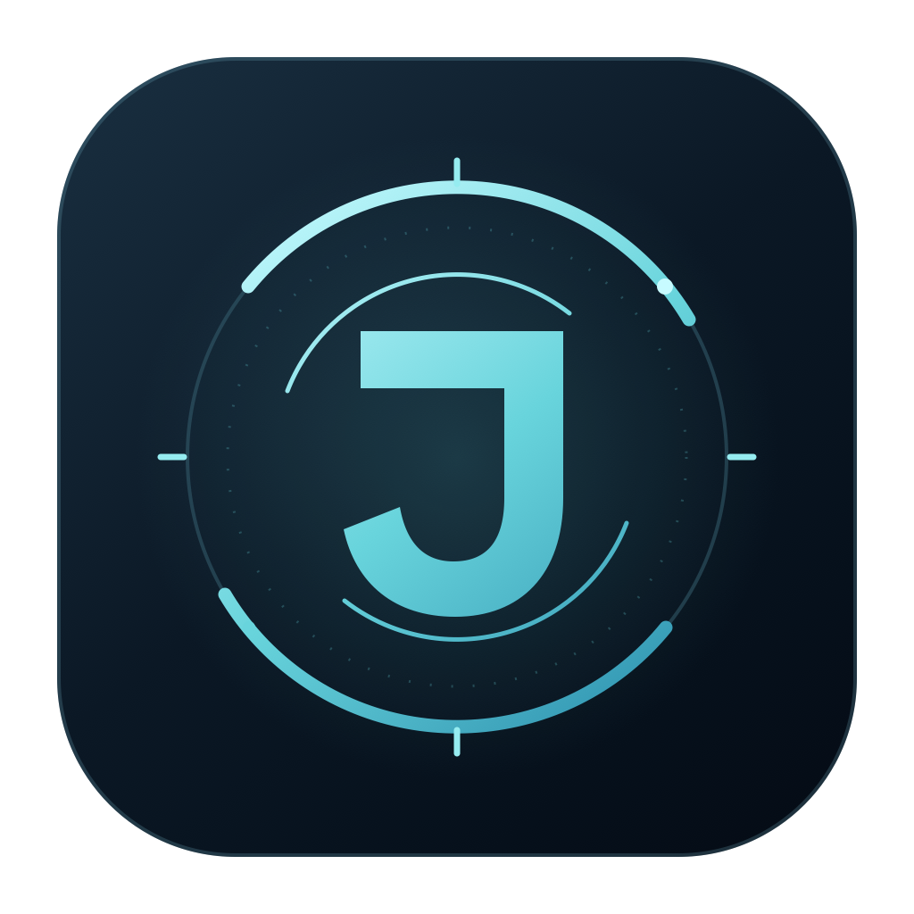

# Jarvis



A personal assistant with a dashboard, local/cloud models, MCP tools, programming, web research, persistent routines, and Second Brain memory. Native macOS voice is complemented by portable Windows and Linux service/dashboard previews.

Built with **React** and a **Python, FastAPI, LangGraph, Deep Agents** service, with **AppKit/WebKit** for the native Mac host. On macOS, close the window and Jarvis keeps running in the menu bar. The computer must remain awake and logged in.

The interface supports **English and Italian**: choose **Settings → Interface → Interface language**. It changes immediately and saves automatically. Documentation and code comments remain English. **You can still speak Italian.** With response language set to `auto`, Jarvis follows substantive requests in Italian, English, or another supported language. English tool results do not force an English reply.

The command center uses a midnight-blue palette, cyan accents, framed panels, and an audio-reactive circular core. Weather, calendar, task activity, Second Brain, and configured models stay connected to real service data. See [interface design and verification](docs/15-command-center-interface.md).

## Native macOS app

The compiled bundle is `dist/Jarvis.app`:

```sh
open dist/Jarvis.app --args --show
```

Select an installed local model or configure a cloud provider in Settings. No model weights or account configuration are included in the repository.

Source installation requires macOS 14+, Xcode/Swift tools, Python 3.12, and Node.js 22.12+.

```sh
./scripts/setup.sh
open dist/Jarvis.app --args --show
```

The bundle is compiled/ad-hoc signed for local use. It references this project and `.venv` through a resource path: **keep the project folder in place**. Rebuild after moving it. A standalone native Mac bundle with an embedded runtime and notarization remains future work.

## Build and run on Windows or Linux

Download the [portable preview release](https://github.com/emanueledibella/jarvis/releases/tag/v0.1.0-portable-preview.4): [Windows ZIP with EXE](https://github.com/emanueledibella/jarvis/releases/download/v0.1.0-portable-preview.4/Jarvis-Windows-x86_64.zip) · [Linux TAR.GZ](https://github.com/emanueledibella/jarvis/releases/download/v0.1.0-portable-preview.4/Jarvis-Linux-x86_64.tar.gz). SHA256 checksum files are included on the release page.

The portable preview includes the Python runtime pinned in `.python-version` and the same React dashboard. Extract the **entire** archive, keeping the executable beside `_internal`. Windows starts with `Jarvis.exe`; Linux starts with `./Jarvis`. The launcher opens the local authenticated dashboard. Keep its console open; **Ctrl+C** stops the service. Closing the browser tab keeps tasks running.

| Capability | Native macOS app | Windows / Linux portable preview |
| --- | --- | --- |
| Dashboard, text, cloud/local models, agents, web, MCP, Second Brain, routines | Available | Available |
| Workspace files and explicitly approved host commands | Available | Available; PowerShell on Windows, `/bin/sh` on Linux |
| Local wake phrase, desktop microphone/OpenAI voice, global voice shortcut | Available | Not included; use text |
| Apple Calendar, Keychain references, native login registration | Available | macOS only; use Google/Microsoft/ICS and local configuration |
| Network-disabled command sandbox | macOS sandbox | Unavailable; confinement requests fail without host fallback |
| Phone conversations | Requires carrier/audio setup | Requires carrier/OpenAI setup; Apple local TTS is unavailable |

Builds target **Windows 10/11 x86-64** and **Linux x86-64 with glibc 2.35+** (Ubuntu 22.04 or later). ARM Windows/Linux and musl/Alpine packages are not provided. These are unsigned preview distributions; signing and native voice parity are future work. See the [platform/build guide](docs/16-cross-platform-builds.md).

### Windows source build — PowerShell

Use Python **3.12+** to bootstrap uv, Node.js **22.12+**, and Git, then run from the repository root:

```powershell
py -3.12 -m venv .bootstrap-venv
.\.bootstrap-venv\Scripts\python.exe -m pip install --upgrade pip==26.2.2 uv==0.13.5
.\.bootstrap-venv\Scripts\python.exe -m uv sync --locked --managed-python --extra dev --extra build --inexact
npm.cmd --prefix web ci --no-audit --no-fund
npm.cmd --prefix web run build
.\.venv\Scripts\jarvis.exe desktop
```

Create the portable archive after the frontend build:

```powershell
.\.venv\Scripts\python.exe scripts/build-desktop.py --skip-web
.\.venv\Scripts\python.exe scripts/smoke-desktop.py
```

Result: `dist/releases/Jarvis-Windows-x86_64.zip`, containing `Jarvis/Jarvis.exe`, its runtime, dashboard, example configuration, and build metadata.

### Linux source build

Use Python **3.12+** with venv support to bootstrap uv, Node.js **22.12+**, and Git. uv downloads the patched runtime pinned in `.python-version`:

```sh
python3.12 -m venv .bootstrap-venv
.bootstrap-venv/bin/python -m pip install --upgrade pip==26.2.2 uv==0.13.5
.bootstrap-venv/bin/python -m uv sync --locked --managed-python --extra dev --extra build --inexact
npm --prefix web ci --no-audit --no-fund
npm --prefix web run build
.venv/bin/jarvis desktop
```

Create and test the native Linux package:

```sh
.venv/bin/python scripts/build-desktop.py --skip-web
.venv/bin/python scripts/smoke-desktop.py
```

Result: `dist/releases/Jarvis-Linux-x86_64.tar.gz`. Extract it and run `./Jarvis/Jarvis`. A desktop browser is needed for the graphical dashboard. Headless mode: `./Jarvis/Jarvis desktop --no-browser` or `./Jarvis/Jarvis serve`.

### macOS builds and release verification

For the native Mac app, use `./scripts/setup.sh` and `open dist/Jarvis.app --args --show` as above. It requires Xcode command-line tools and grants macOS voice/calendar permissions to the native bundle. To use the universal Python lock on an existing source checkout, use the Linux venv/uv commands above, then `./scripts/build-macos.sh`.

PyInstaller builds **on each destination OS**, rather than cross-compiling Windows/Linux packages on the Mac. The [Portable builds workflow](.github/workflows/portable-build.yml) runs Python tests on all three systems, Swift tests on macOS, and actual frozen-app checks on Windows/Linux. Those checks exercise authentication, dashboard assets, Deep Agents, SQLite checkpoints, and the time tool against a loopback model fixture. They never use a real provider key or make a paid model call.

Each archive has a sibling `.sha256` checksum and `BUILD-INFO.json` with its source revision and lockfile hash. Verify downloads with `Get-FileHash <archive> -Algorithm SHA256` on Windows or `sha256sum -c <archive>.sha256` on Linux. No provider keys, settings, OAuth state, memory databases, or model weights are shipped. Local models and external developer tools must be installed separately.

## First use

Choose **Settings → Interface → Interface language** (or **Impostazioni → Interfaccia → Lingua dell’interfaccia**) to switch the entire dashboard and native Mac menus between English and Italian. The preference survives restarts and syncs open dashboards. It is independent of wake recognition and conversation language. Set `JARVIS_UI_LANGUAGE=en` or `it` only when the environment should control and lock this preference. See the [interface language guide](docs/18-interface-language.md).

1. **Models:** select runtime/model in Settings and run “Test tool calling”. Configure cloud key, model ID, and input/output rates. Hybrid chooses configured cloud or otherwise local at task start, without mid-task fallback.
2. **Voice and presence (native Mac app):** enable voice, choose Apple or OpenAI Live, and grant Jarvis Microphone/Speech Recognition. Live keeps wake detection local and sends conversation audio once a request starts. A brief local listening cue can play after a wake-only pause; continuing the question suppresses it and late cues are skipped. Set **Response language → Auto** to speak Italian or English. Recognition language remains separate, initially `it-IT`. Say “Jarvis” or **“Jarvis, che ore sono?”**. Shortcut: **⌘⇧J**. See the [OpenAI voice guide](docs/13-voce-openai.md) and [wake timing](docs/19-wake-response-timing.md). Launch at login is optional in Settings/menu. Windows/Linux currently use text conversation with the same response-language policy.
3. **Memory:** configure the canonical Second Brain MCP endpoint and dedicated Bearer/OAuth connection. “Connect Second Brain” opens consent where needed; Jarvis does not reuse Codex credentials. Corrections need their separate option/OAuth scope.
4. **Productivity:** choose weather city/calendar. Apple EventKit, Google, Microsoft, and read-only ICS are available. Apple needs Productivity consent; cloud calendars need their account credentials.
5. **Telephony:** configure Twilio, caller/owner numbers, PIN, and an HTTPS/WSS proxy limited to `/telephony`. A test call starts only from the authorized action. No paid calls were made during development.

Text chat, authorized workspace tools, and reminders work without completing every connection.

**Interrupt by speaking:** with OpenAI Live on the Mac, select **Settings → Voice → Microphone during playback → Automatic · interrupt by speaking**. Local echo cancellation protects the microphone while a speech detector stops playback when you speak. Unsupported processing keeps the manual ⌘⇧J fallback. Existing installations retain their saved mode until changed. See the [spoken interruption guide](docs/20-spoken-interruption.md) for conversation continuity and device validation.

**Configure lights:** open **Settings → Lights and devices**. Choose a model/capability profile, a name for voice commands, and either native **Hue Bluetooth without a Bridge** or a compatible **MCP lighting service**. Bluetooth pairing requires the Mac app and explicit device selection. MCP adapters use tools already allowed in Connections and configurable field mappings. Direct voice control is a revocable grant for each light; otherwise commands retain dashboard approval. See [lighting setup](docs/21-lighting-integrations.md).

Keep the **MacBook lid open** for its built-in microphone. Apple Silicon physically disconnects it when closed, even with an external display and granted permissions. For closed-lid use, select external input in Sound → Input. Source: [Apple hardware security](https://support.apple.com/en-gb/guide/security/secbbd20b00b/1/web/1).

## Environment configuration

Source checkout on macOS/Linux:

```sh
cp .env.example .env
chmod 600 .env
```

On Windows, use `Copy-Item .env.example .env` in PowerShell and keep that file private to your account. Portable executables look for `.env` in their private application data directory, instead of the extraction folder; the included `jarvis.env.example` is a template. Alternatively, select a file explicitly: `.\Jarvis.exe --env-file C:\path\jarvis.env desktop` or `./Jarvis --env-file /path/jarvis.env desktop`.

Uncomment only env-managed settings. Example:

```dotenv
JARVIS_PROFILE=local_connected
JARVIS_LOCAL_PROVIDER=ollama
JARVIS_LOCAL_BASE_URL=http://127.0.0.1:11434
JARVIS_LOCAL_MODEL=exact-installed-model-name
JARVIS_LANGUAGE=it-IT
JARVIS_RESPONSE_LANGUAGE=auto
```

Precedence: process environment → `.env` → private GUI settings → defaults. Env-imposed fields are locked in the GUI; restart the service after file changes. The [complete env schema](docs/12-configurazione-env.md) lists all 93 settings, types, defaults, and constraints.

Data is separate from source: `~/Library/Application Support/Jarvis` on macOS, `%LOCALAPPDATA%\Jarvis` on Windows, and `$XDG_DATA_HOME/Jarvis` or `~/.local/share/Jarvis` on Linux. It holds private settings, the local token, database, checkpoints, approvals, and memory queue. Private-session content stays in service RAM and cannot be recovered after restart. Ordinary history follows configured retention.

## Tools and control

- Time, weather, calendar, web, memory, workspace, routine tools; HTTP/stdio MCP servers with explicit schemas/permissions.
- File read/write with path, symlink, SHA-256 revision checks; reviewable diffs and command timeouts.
- Action/argument-bound approvals; dashboard reconciliation for uncertain outcomes. Model confirmation text cannot authorize an action.
- Model-free reminders, agent jobs, JSON monitors that notify actual changes. Policy-driven sleep recovery; expired calls are skipped.
- Bidirectional μ-law phone audio, PIN before private data, interruption, proposal-bound DTMF 1/2 approval.
- Top-bar emergency stop blocks new work/tools, interrupts active tasks, stops voice/calls. It does not undo completed effects.

`local_strict` uses only a loopback model and permitted local capabilities. It disables MCP, web, remote memory, cloud voice, telephony; commands require the network-disabled sandbox. Other profiles permit connected services according to policy.

## CLI and development

```sh
.venv/bin/jarvis doctor
.venv/bin/jarvis status
.venv/bin/jarvis ask "What time is it? Use current_time."
.venv/bin/jarvis mute
.venv/bin/jarvis tasks
```

Browser-only mode: `.venv/bin/jarvis serve`, then `.venv/bin/jarvis open`. The native host supplies microphone, Apple Calendar, menu bar, login. A lock prevents multiple services owning one data directory.

```sh
.venv/bin/pytest -q
.venv/bin/ruff check src tests
npm --prefix web run build
./scripts/build-macos.sh
./scripts/test-native.sh
```

Cross-platform dependencies are locked in `uv.lock`; frontend dependencies are pinned in `web/package-lock.json`. Optional local phone STT: `.venv/bin/pip install -e '.[voice]'`, then explicitly preload a model before calling, for example `.venv/bin/python -c "from faster_whisper import WhisperModel; WhisperModel('small', device='cpu', compute_type='int8')"`. Calls use only already-available model files.

The editable logo is [web/src/assets/jarvis.svg](web/src/assets/jarvis.svg). `scripts/build-icon.sh` renders the PNG and full standard/Retina macOS ICNS without an image-generation API. Bundle builds install the icon for Finder, Dock, and application switching. The dashboard and favicon share the mark.

## Security

Read the [security policy](SECURITY.md) and [audit/remediation record](docs/17-security-audit.md). Git history was rewritten to remove identifying metadata and local installation records. Older clones must be replaced or carefully rebased; do not merge the old history back. The hardened preview replaces the previous portable release.

## Analysis and verification

The [dossier](docs/README.md) contains GitHub research, 132 requirements, architecture, and decisions. The [implementation design](docs/10-progetto-esecutivo.md) records implemented choices. The [operations/coverage guide](docs/11-implementazione-e-verifica.md) distinguishes automated tests, real experiments, and integrations awaiting authorization. Existing document filenames are retained to preserve links.

The current regression suite collects **172 Python tests**, with platform-specific skips, plus **115 Swift regression scenarios** on macOS. Validation also checks TypeScript/Vite, Python lint, Mac bundle compilation/signing, and actual Windows/Linux executables. See [platform verification evidence](docs/16-cross-platform-builds.md#verification-results) for the earlier portable baseline, [wake timing](docs/19-wake-response-timing.md), [spoken interruption](docs/20-spoken-interruption.md), and [lighting](docs/21-lighting-integrations.md) for the added cases.

Account-specific integration tests should be recorded privately. Public regression tests use synthetic fixtures and never need a personal provider key, calendar, phone number, or memory corpus.

Apple wake recognition uses on-device transcript word boundaries. Accuracy, false triggers, echo, consumption, sleep recovery, and real multilingual dialogue need device testing. Native language tests verify Italian/English voice selection; mocked voice tests verify protocol, language instructions, privacy, and delegation, rather than claiming real provider speech quality. Telephony and authenticated calendars require their actual accounts/permissions.
