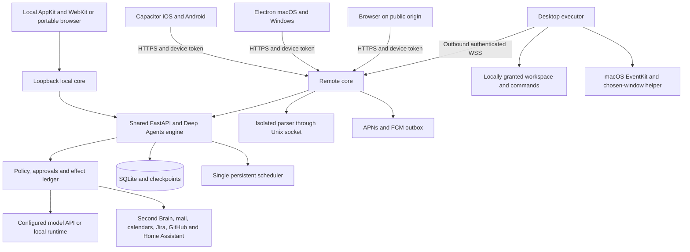

# Architecture

Updated November 3, 2026. Jarvis has a shared Python/React implementation with
**local standalone** and **remote core + companion + desktop executor** deployment
modes. The original Mac-only design has evolved; current coverage and verification
are in [chapter 33](33-current-state-and-verification.md).

## 1. One authority per installation

The authority owns conversations, task checkpoints, policy, approvals, effect
receipts, schedules, budgets, integrations and persistent feature data. SQLite
and APScheduler remain appropriate to the delivered single-owner, single-core
deployment. A remote VM does not require Postgres, Redis or a cluster.

Run one core/scheduler for each data directory. Never share a live SQLite/WAL
directory between Mac and server or run the same routines on both. The local
app remains a separate installation; it is not an automatic offline replica of
the remote core.

## 2. Implemented topology

The diagram shows shared implementation, not simultaneous local/remote ownership
of one database. Local mode can select local/cloud profiles. Remote mode uses
the configured cloud provider and cannot dispatch model inference to the desktop.

## 3. Processes and platform boundaries

| Component | Implementation and responsibility |
| --- | --- |
| Local Mac host | AppKit/WebKit, Python supervision, menu bar/login, Apple Speech, microphone/playback, EventKit, Hue Bluetooth and one-window capture |
| Local portable launcher | Frozen Python service plus system-browser dashboard on Windows/Linux; text interaction |
| Shared core | FastAPI, LangGraph/Deep Agents, typed gateway, budget/effects, SQLite, schedules and feature modules |
| Remote companion desktop | Electron, sandboxed renderer, restricted IPC, OS credential storage, tray/login and executor supervision |
| Remote companion mobile | Capacitor, shared React UI, iOS Keychain/Android Keystore, explicit recording, push registration and native sharing |
| Desktop executor | Separate Python process/identity, OS vault, local grants, effect journal, reconnection and cancellation |
| Remote macOS helper | EventKit and ScreenCaptureKit through a locally approved, hash-pinned native helper; no general GUI control |
| Document worker | Bounded parser process; remote Compose isolates it from network, credentials and the core data volume |
| Public proxy | Caddy HTTPS/WSS to the remote core; local managed telephony uses its own restricted Caddy/Cloudflare path |

Tauri and Pipecat were research candidates, not dependencies of the local host.
React Native was a mobile candidate; the delivered mobile shell is Capacitor.
Electron is now a dependency of the remote desktop companion. Local native
wake/echo processing and Hue Bluetooth are not part of the executor protocol.

## 4. Authentication and session contracts

Local mode binds to loopback and authenticates with a private owner token.
CLI/native/browser clients verify the service identity before disclosing it.
The local native bridge and Live audio WebSocket never become public.

Remote mode has a dedicated boundary in `remote.py`: public protocol discovery,
one-use pairing, rotating refresh, device grants, allowed Host/Origin and bounded
requests. The first administrator pairs with a CLI-issued owner code.
Administrators can issue companion/executor codes and revoke devices.
Pairing is a personal-device protocol, not an OIDC implementation.

Companions call shared `/api/*` routes with a short-lived bearer and
`X-Jarvis-Session`. `ClientContext` resolves the device/session before tools run.
Ordinary conversations are available across the owner's devices in the same scope;
private content and temporary sources require the originating session.
Settings writes require the current `ETag` in `If-Match`; stale writes return 409.

Remote clients poll `/remote/v1/events?after=...`. Local `/api/events`,
`/api/native*`, `/api/voice/live*` and native voice control are denied by the
remote boundary. Telephony keeps carrier-signature/media-token authorization.

## 5. Task, tool and effect flow

1. Accept a request with stable delivery ID, conversation, scope, privacy and
   permitted profile. Snapshot the model/endpoint and execution parameters.
2. Retrieve relevant scoped memory and selected source evidence. Treat tool,
   document, email, calendar, screen and web content as untrusted data.
3. Deep Agents plans and calls schema-validated gateway tools with time, step,
   concurrency and budget limits. Framework files are a virtual scratchpad.
4. If required, interrupt for the exact action/arguments and bind the decision to
   task, hash and expiry. Model prose or a notification cannot approve an effect.
5. Claim mutations in the durable effect ledger. An unknown external outcome
   requires reconciliation instead of automatic repetition.
6. Record verified results and expose progress/results to authorized clients.
   Stopping speech does not by itself cancel an accepted task.

Deterministic reminders, calendar analysis, source baselines and notifications
avoid model polling. Event-triggered analysis tasks are read-only at the gateway,
including after checkpoint reconstruction.

## 6. Device dispatch

The core exposes `device_workspaces`, `device_read`, `device_write` and
`device_command`. Device/workspace IDs select the destination; absolute desktop
paths stay in local configuration. The executor opens `/remote/v1/executor`
over WSS; no listener or phone-to-desktop connection is required.

Every job binds destination, operation, arguments/hash, scope, task/session and
expiry. The executor rechecks local read/write/command grants, confinement,
expected file hash and permitted command prefixes. Core approval cannot enlarge
a local grant. Host commands run project code with the OS user's authority.

Jobs progress through `queued`, `delivered`, `claimed`, `running` and terminal
`succeeded`, `failed`, `cancelled`, `expired` or `unknown`.
Receipt retransmission does not re-execute an operation. Disconnect/restart after
dispatch can leave uncertainty. Offline waiting is opt-in and capped at ten
minutes; private jobs cannot queue while the device is offline.

Selecting an executor also routes supported Apple calendar/window operations.
A window still needs local selection. Native Bluetooth, arbitrary mouse/keyboard
control, delegated local AI and server coding sandboxes are outside this protocol.

## 7. Feature data and persistence

| Data | Authority and retention |
| --- | --- |
| Conversations/checkpoints | Core database; ordinary retention; private content in RAM |
| Personal/work facts | Canonical Second Brain, with source/revision and separate adoption state |
| Projects/activities, drafts and rules | Scoped feature records with explicit revisions/deletion; private persistent edits blocked |
| Documents | Normalized extracted evidence, hashes and cited parts; 1–365 day retention; private sources expire in RAM after one hour |
| Chosen windows | Session-bound RAM only, ten-minute expiry and immediate deletion |
| Device jobs and receipts | Remote store plus executor journal; private result content not journaled; uncertain effects retained |
| Push | Encrypted device tokens, generic payload and bounded outbox retries |
| Credentials | Private local settings/Keychain references; remote model/integration/OAuth secrets encrypted with the core master key |

Encryption at rest is not end-to-end encryption against the VM administrator.
The core must process data and send permitted context to the selected model.

Directory/document workspace tools use the core host's filesystem. They do not
watch or mount an executor's folders. Remote mode grants no host workspace or
command execution by default. Uploaded documents use the isolated parser broker.

## 8. Voice, availability and deployment

Local Mac voice has Apple and optional OpenAI Live paths, with local wake,
guarded recovery, microphone selection and echo-protected interruption.
Companion voice instead records an explicit WAV, transcribes for review, submits
text and optionally requests TTS. Phone calls use their separate Twilio bridge.
These have different transports, permissions, costs and availability.

A remote core continues server-side work with a sleeping/offline desktop.
Local file/native operations need that desktop connected. Second Brain and Home
Assistant need an independently available network/service path. Closing a mobile
app does not cancel accepted server work; push delivery remains OS/provider-dependent.

Compose supplies one non-root core, a network-disabled parser and HTTPS proxy,
private volumes and health checks. The core keeps its database locally.
Encrypted age restore revokes old device credentials/pairing, disables schedules,
sets emergency stop and makes pending dispatch uncertain before reuse.

See [deployment](../deploy/README.md), [companion build/pairing](../companions/README.md),
[configuration](12-configurazione-env.md) and [security](../SECURITY.md).
Production hosting, signing, real-device/account checks and high availability
are separate from the verified source implementation.
