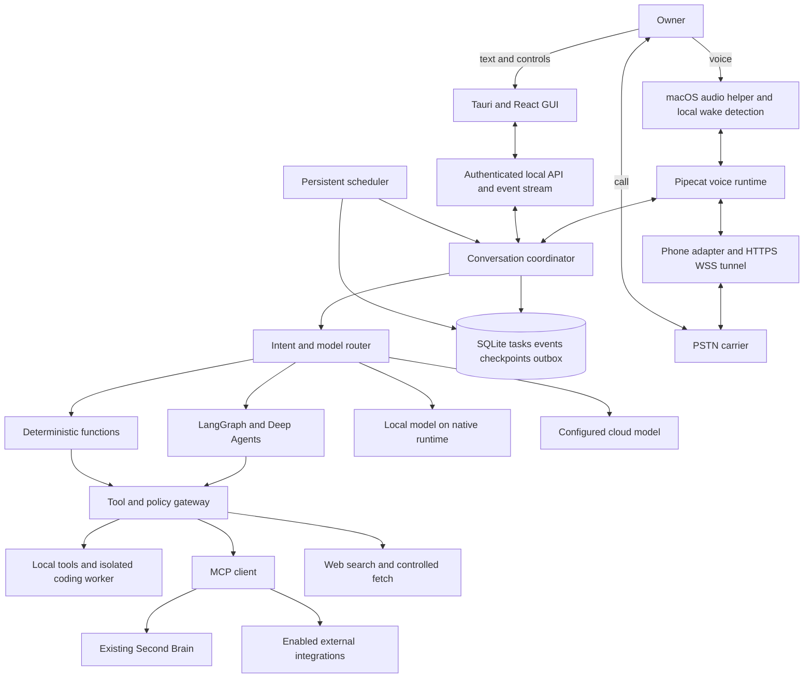
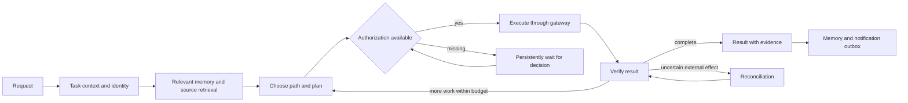
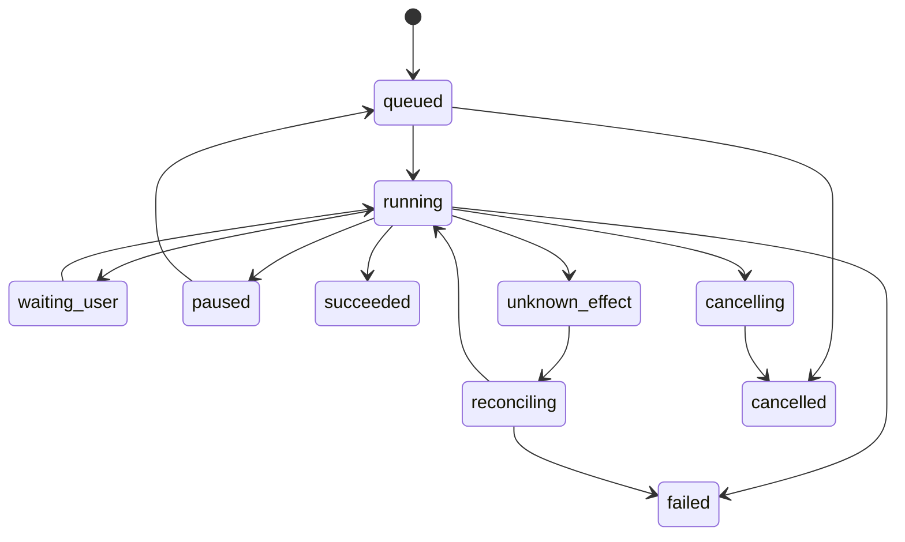

# Proposed architecture for the first Mac installation

This document records **proposals to validate**. The confirmed constraint is one initial Mac with local and cloud models. Servers, Redis, clusters, and distributed services are not prerequisites for the core. Chapters 10–13 describe the implementation decisions that followed this proposal.

## 1. Components and responsibilities



Blocks represent responsibilities, not a microservice for each box. A few processes with clear interfaces suffice initially.

| Process | Responsibility | Independent of the window |
| --- | --- | --- |
| Desktop/menu bar host | Onboarding, UI, notifications, service control | Yes, as a background host |
| Signed audio helper or equivalent native component | Capture, audio device, levels, mute, playback | Yes; no visible-page dependency |
| Python service | Conversations, graph, gateway, scheduler, database, voice pipeline | Yes, supervised |
| Coding worker | Commands, filesystem, checks for one job | Only during the task |
| Local model runtime | Profile-dependent LLM/STT/TTS inference | Configurable startup or residency |
| Phone tunnel | Expose only required webhook/media endpoints | While telephony is enabled |

Choose **one service lifecycle owner**: a persistent host or system-managed helper. Avoid three copies created by autostart, GUI, and development scripts. Modern macOS `SMAppService` supports login helpers/services; test the actual bundle. Source: [Apple Service Management](https://developer.apple.com/documentation/servicemanagement/smappservice).

## 2. Recommended stack and alternatives

| Area | First choice | Alternative / condition |
| --- | --- | --- |
| Backend | Python 3.12 candidate, FastAPI, Pydantic contracts | Freeze versions after audio/native dependency tests |
| Agents | LangGraph + Deep Agents using our gateway tools | Pydantic AI if experiments show lower complexity for the same requirements |
| MCP | SDK-independent internal interface; evaluate `langchain.mcp.MCPAdapter` | Official MCP/FastMCP adapter if beta stability is insufficient |
| Voice | Pipecat | LiveKit Agents if telephony/WebRTC is simpler |
| GUI | Tauri 2 + React + TypeScript | Electron if audio, distribution, and integrations become substantially easier |
| Orb graphics | SVG/Canvas 2D and Web Audio/native metering | WebGL only after demonstrating a resource-use benefit |
| Local state | SQLite, WAL, migrations, one coordinator | PostgreSQL for a server deployment or increased concurrency |
| Checkpoints | Persistent saver matching the chosen LangGraph version | SQLite for personal use with concurrency/crash tests; Postgres for a future service |
| Scheduling | APScheduler with persistent jobs and our effect ledger | Temporal for durable distributed orchestration, not initially |
| Local inference | Native Ollama; supported LM Studio endpoint | MLX/llama.cpp adapter if useful for actual hardware |
| Secrets | macOS Keychain; env for configuration/development | Portable secret references for a future server |

LangGraph distinguishes conversation checkpoints from application stores, notes that in-memory savers lose state on restart, and presents SQLite as a local development option. Personal-use SQLite is our pragmatic choice to qualify, not a framework guarantee. Source: [persistence](https://docs.langchain.com/oss/python/langgraph/persistence).

APScheduler documents persistent stores and misfire recovery. Do not share a job store across schedulers or persist user-provided callables: jobs invoke fixed application entry points. Source: [APScheduler](https://apscheduler.readthedocs.io/en/stable/userguide.html).

## 3. Three execution paths

### Deterministic command

Examples: mute, stop speech, open dashboard, service status, a structured timer. Typed parsing/functions avoid unnecessary agents. Initial natural-language interpretation may use a model; controlled code applies the effect.

### Short conversation

A request needing a few tools: weather, agenda, memory, or a question. Retrieve targeted sources, answer briefly, and allow follow-up. Cached results show freshness. The same gateway enforces policy and audit.

### Long-running work

Research, coding, document comparison, or monitoring: create a persistent task and immediately return its ID. A worker may use Deep Agents/specialists with explicit budgets. Attach the final result and notify according to rules.

The owner can ask another question meanwhile. Coding must not leave the microphone unusable until completion.

## 4. Agent graph



Check authorization for each tool as well. A favorable graph decision does not grant credentials or unrestricted permanent access.

Enable planning explicitly in profiles that need it: since Deep Agents v0.7 it is not always-on middleware. Source: [planning](https://docs.langchain.com/oss/python/deepagents/overview#task-planning).

## 5. Proposed internal roles

| Role | When needed | Minimum context and tools |
| --- | --- | --- |
| Coordinator | Every request | Identity, policy, task state; no unrestricted shell |
| Researcher | Comparisons and current questions | Search, fetch, extraction, bibliography |
| Programmer | Implementation/debugging | One repository, Git, files, worker commands |
| Productivity operator | Agenda, notes, tasks | Relevant provider adapter |
| Memory curator | Complex recall/writes | Second Brain and relevant original source |
| Voice interlocutor | Desktop and phone | Current summary and task-delegation functions |

These are logical boundaries, not six models for a simple request. Delegation must improve accuracy or elapsed time before becoming a default.

## 6. Separate voice from long-running work

The voice runtime owns turn-taking, interruption, and playback; the coordinator owns tasks, authorization, and sources. A `start_task` facade returns an ID; `get_task_status` retrieves a summary. Long execution never blocks the audio thread.

Cloud speech-to-speech receives only permitted facade tools, such as agenda retrieval or starting research. Actual calls still use the gateway. The cloud model receives no MCP credentials or unrestricted shell.

Only one component may modify/execute each tool call. Events replicated across frontend, sideband, and backend share an ID and owner to prevent duplicate execution. Pattern source: [OpenAI server-side controls](https://developers.openai.com/api/docs/guides/voice-server-controls).

## 7. Tool gateway

Proposed application contract, independent of the external protocol:

```text
ToolSpec:
  id, version, origin, input_schema, output_schema
  capability, allowed_scopes, execution_location
  side_effect_kind, required_authority, timeout
  idempotency_strategy, cancellation_strategy

Invocation:
  invocation_id, task_id, operation_key, arguments_hash
  authorization_reference, state, provider_reference
  started_at, finished_at, result_reference, error_code
```

MCP annotations such as `readOnlyHint` and `destructiveHint` are classification hints, not sufficient permission. Unknown servers use gateway-owned mapping and may require review before enabling a capability.

Each server has managed processes/connections, dedicated credentials, timeouts, circuit breaking, and versioned tool schemas. Unexpected schema changes cannot expand already-approved privileges.

Current LangChain documentation moves toward beta `langchain[mcp]` and `MCPAdapter`. Domain code should not couple directly to that API in many places. Source: [LangChain MCP](https://docs.langchain.com/oss/python/langchain/mcp).

## 8. Persistence and data model

| Entity | Required data | Purpose |
| --- | --- | --- |
| `Conversation` / `Turn` | Channel, scope, content/task references | Continuity without mixing voice, identity, and tasks |
| `Task` / `TaskRun` | Goal, state, policy, model, budget, checkpoint | Resumption and reporting |
| `Schedule` | Zone, trigger, next due time, tolerance, misfire policy | Reliable daily execution within Mac availability |
| `Effect` / `ToolInvocation` | Operation key, state, provider reference | External-effect reconciliation |
| `Approval` | Proposal, argument hash, identity, expiry, scope | Decision valid for one specific action |
| `Notification` | Event, channel, fingerprint, attempts, outcome | Deduplication and escalation |
| `MemoryOutbox` | Original source, scope, `request_id`, Second Brain state | Retain writes without blocking voice |
| `Integration` | Type, capability, secret reference, state | No plaintext key in the domain database |
| `Artifact` | Private path, type, hash, sources | Reviewable, portable results |

SQLite WAL helps concurrency but does not remove locks or the need for short transactions. Checkpoints and domain tables may use separate files. Serialize critical mutations and limit worker concurrency.

## 9. Task and effect states



Graph checkpoints do not guarantee **exactly once** for calls, sends, or remote writes. Use provider idempotency where supported; otherwise record intent before the effect and reconcile the provider ID. A lost creation response remains uncertain until verified.

Leases prevent two workers from owning one task; restart recovers expired leases and examines the last effect. An in-memory lock alone cannot recover a crash.

## 10. GUI events

Proposed contract, not an already-implemented API:

```json
{
  "event_id": "uuid",
  "sequence": 42,
  "occurred_at": "timestamp-UTC",
  "task_id": "uuid-or-null",
  "conversation_id": "uuid-or-null",
  "type": "tool.completed",
  "data": {"tool_id": "calendar.list_events", "result_ref": "artifact-id"}
}
```

Minimum events: `service.status`, `voice.state`, `audio.level`, `transcript.partial`, `transcript.final`, `task.updated`, `tool.started`, `tool.completed`, `approval.requested`, `memory.status`, `call.status`, `notification.updated`.

Audio levels are ephemeral, outside the event ledger. Task mutations are persistent with reconnect ordering and compact snapshots. Resume at the latest sequence or request a snapshot when retention has removed events.

## 11. Local and cloud inference

The router selects profile-permitted models according to data classification, verified capabilities, and resources, rather than unrestricted model judgment about the “best” provider.

- **Strict local:** local LLM/STT/TTS; blocked egress except explicit exceptions. Remote MCP/web are unavailable unless authorized by the profile.
- **Local with connected services:** local inference with permitted remote calendar/web/MCP; GUI makes the distinction visible.
- **Cloud:** configured cloud LLM, profile-dependent voice, gateway-controlled tools.
- **Hybrid:** select a candidate by role/task; private requests cannot migrate to cloud without compatible authority.

Ollama documents tool calling; LM Studio exposes compatible tool endpoints. Transport compatibility does not establish model quality against our schemas. Sources: [Ollama](https://docs.ollama.com/capabilities/tool-calling), [LM Studio](https://lmstudio.ai/docs/developer/openai-compat/tools).

## 12. Memory and context

Checkpoints hold observable operational state, necessary messages, results, and references. Second Brain holds personal/work facts, evidence, and revisions. Artifacts retain reports/code. A project knowledge base can index documents without becoming a biographical preference ledger.

The first release does not need another Neo4j, Mem0, or personal-memory vector database. Document knowledge can start with text search and file citations; semantic indexing is an optimization to justify.

## 13. Future server path

Coordinator, scheduler, and telephony could move to an always-available machine while wake detection, audio, and local tools stay on the Mac. Adapters declare `execution_location` and handle temporary Mac unavailability. Preserve that boundary now without building a distributed control plane.

Migration would require Postgres, device pairing, authenticated command transport, and revised operational guarantees. It is not merely an env-variable change.
