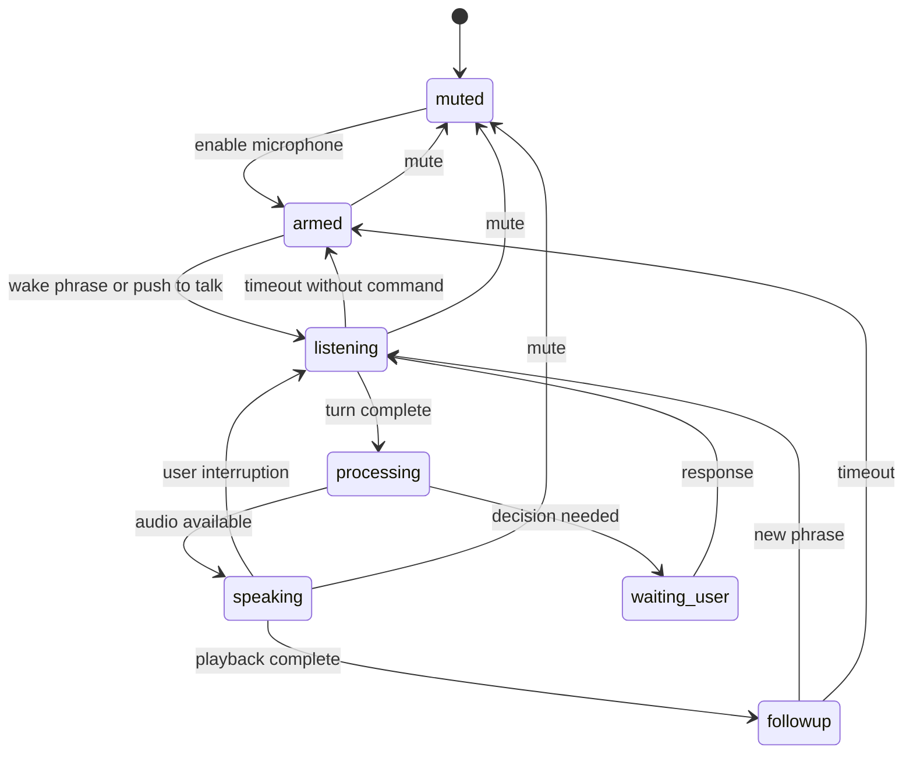
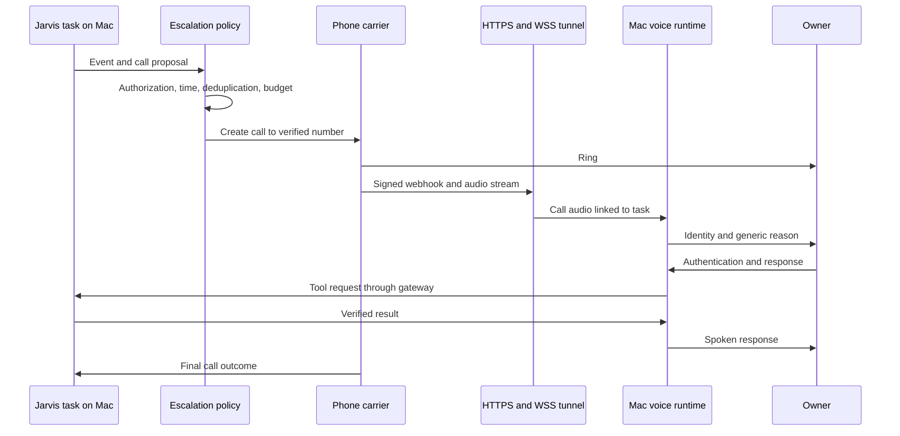

# Voice, continuous presence, and telephony

This chapter is the initial design dossier. [Chapter 13](13-voce-openai.md) describes the implemented OpenAI Live path and multilingual behavior.

## 1. What “always active” means initially

| Mac state | Wake detection | Local tasks | Calls |
| --- | --- | --- | --- |
| Awake, logged in, window hidden | Yes, after microphone authorization | Yes | Yes with network and phone path active |
| Screen locked | Validate on the real bundle; optionally disabled for privacy | Compatible jobs continue | Possible with service, credentials, and network; unverified until tested |
| Display off, system awake | Yes if an audio device is available | Yes | As above |
| System asleep | No detection promise | Suspended | No calling/dialogue promise |
| Powered off or no user session | No | No | Not through the local core |
| No network | Local voice available | Only jobs with local dependencies | No PSTN/cloud |

Display-off, lock, and sleep are distinct. Keeping the system awake is an explicit preference affecting battery/temperature. Jarvis does not change Mac power management automatically.

During setup, the owner grants permissions and chooses launch at login. Afterwards, opening a chat must not be necessary to speak. Microphone-using bundle/process identity should remain stable across updates. Source: [SMAppService](https://developer.apple.com/documentation/servicemanagement/smappservice).

## 2. Desktop pipeline

```text
Microphone
  → native capture + short RAM buffer
  → normalization / noise reduction / echo cancellation
  → local wake detection
  → visual or audible activation signal
  → VAD and turn detection
  → local or cloud STT according to profile
  → coordinator and tools
  → synthesized text / native model audio
  → playback with actual orb metering
```

A pre-trigger buffer avoids losing the command spoken alongside the wake phrase. Initial proposal: 1–2 seconds in RAM, continuously overwritten, never on disk. Cloud STT transfers should include only the necessary segment and respect the profile.

Waiting for “Jarvis” needs no model request. The microphone is nevertheless open locally; show that state clearly.

## 3. “Jarvis” alone is a specific requirement

The pretrained openWakeWord model detects **“hey jarvis”**. An env value `WAKE_WORD=Jarvis` cannot change an acoustic model's vocabulary. Select/train an appropriate keyword and test Italian pronunciation, distance, and real noise. Source: [openWakeWord models](https://github.com/dscripka/openWakeWord).

| Candidate | Advantages | Required experiment |
| --- | --- | --- |
| openWakeWord | Open code, local execution, custom keywords | ONNX/dependencies on macOS arm64; exact “Jarvis” model and false positives |
| Porcupine | macOS SDK, custom keywords, on-device inference | AccessKey, plan conditions, language/platform-specific keyword |
| Apple Speech on-device | Native integration, customizable vocabulary | Actual offline language support, consumption, OS versions; continuous transcription rather than necessarily a dedicated detector |

Porcupine requires an AccessKey and publishes macOS SDKs. Check runtime/model terms beyond the repository license. Source: [Porcupine](https://picovoice.ai/docs/porcupine/).

OpenClaw's macOS documentation illustrates Apple Speech wake detection: the inspected version requires macOS 26.2 and local recognition for the chosen language. That project's constraint does not automatically apply to our detector. Source: [OpenClaw voice wake](https://github.com/openclaw/openclaw/blob/7bd68959a21b2dfb75dcad78d9d584f304107b0b/docs/platforms/mac/voicewake.md).

## 4. Conversation states



Device errors can also make any state `unavailable`; text and independent tasks remain available. Do not compress service state and individual conversation state into one indicator.

### Proposed semantics

| Command | Effect |
| --- | --- |
| “Jarvis” | Open a turn and indicate listening |
| “Jarvis, what will the weather be?” | Open the turn and preserve the question in the same audio |
| “Stop” during speech | Stop turn audio/generation; long-running work continues unless cancelled |
| “Cancel the research task” | Stop future steps of the identified task and summarize completed effects |
| “Stop listening” | Release the microphone until manual reactivation or configured shortcut |
| “Do not remember this conversation” | Prevent new memory writes; other logs depend on the indicated private mode |

Closing the microphone cannot simultaneously guarantee later voice reactivation: a physical control or another channel is required.

## 5. Interruption and echo

Two-way conversation requires more than VAD:

1. Detect user speech during assistant playback.
2. Prevent speaker output from reactivating the wake phrase or becoming a new command.
3. Stop generation, local playback, and transport-queued audio.
4. Record only speech actually delivered, where observable.
5. Resume from the interruption without duplicating completed tool actions.

Compare AEC, headphones, thresholds, and microphone position on the actual Mac. Always disabling input during speech avoids some false triggers but does not fulfill fully interruptible dialogue.

The renderer receives aggregate playback levels. Token-driven animation can pulse while nothing is audible, which is not the final intended meaning.

## 6. Two conversation modes

| Property | STT → LLM → TTS | Native speech-to-speech |
| --- | --- | --- |
| Reasoning model | Any candidate supporting tools and streaming | Provider-supported audio model |
| Fully local execution | Possible with suitable engines/hardware | Depends on a specific local stack |
| Transcription/debugging | More explicit | Availability/timing depends on service |
| Naturalness/turn-taking | Integrate and measure | Often more integrated, without a universal guarantee |
| Costs | Separate STT, tokens, TTS | Audio model and transport pricing |
| Portability | Higher | Specific protocol/capabilities |

Initial proposal: a composable baseline plus optional native cloud mode for quality/latency comparison. Pipecat and LiveKit document both pipelines and realtime models. Sources: [Pipecat](https://github.com/pipecat-ai/pipecat), [LiveKit Agents](https://github.com/livekit/agents).

For Italian, evaluate names, phone numbers, dates, technical acronyms, and switching between code/English and Italian. One English demo sentence is insufficient.

## 7. Calling requires a telephone-network connection

A carrier account, permitted number/caller ID, credentials, destination coverage, credit, and an audio bridge are necessary. An SDK does not establish Italian number availability or number type.

### Recommended initial path: carrier and Mac bridge



Twilio creates calls through its API and uses **bidirectional** `<Connect><Stream>`. A one-way stream is insufficient. Documentation requires reachable WSS and `X-Twilio-Signature` verification. Sources: [Call resource](https://www.twilio.com/docs/voice/api/call-resource), [Media Streams](https://www.twilio.com/docs/voice/media-streams).

The tunnel exposes only `/telephony/...`, not the entire local API, filesystem, administration GUI, or Second Brain. Verify signatures against the correct public URL, accounting for the proxy. Carry media-session identifiers/tokens through provider parameters rather than logged URL secrets.

Dodaios documents a similar bridge with separate VPS/local-computer paths. It is a useful reference, not code to import without review. Source: [Dodaios telephony](https://github.com/Dodaios/Dodaios/blob/c2aeac0c642024b9207cf340cde19cd4b288d6c2/docs/telephony.md).

## 8. Phone alternatives

| Alternative | Benefit | Cost / dependency |
| --- | --- | --- |
| Pipecat + Twilio/Telnyx/another carrier | Control STT/LLM/TTS and share the desktop pipeline | Implement/qualify audio bridge and transport handling |
| LiveKit Agents + SIP | Dedicated sessions/telephony stack, useful for multiple clients | Managed or self-hosted LiveKit/SIP; unnecessary for local listening alone |
| Direct SIP to cloud audio service | Less Mac media processing | Greater provider/model/access dependency |

Current OpenAI documentation distinguishes Realtime SIP ingress from **Live API** outbound calls. Outbound requires organization enablement and a compatible trunk; a Realtime API key alone does not establish availability. Pin a supported adapter path and test the actual account. Sources: [Telephony and SIP](https://developers.openai.com/api/docs/guides/voice-sip), [Create Live session](https://developers.openai.com/api/reference/resources/live/methods/create).

A carrier bridge best fits the initial Mac-only installation and interchangeable models. Final choice depends on Italian quality, number availability, cost, and authentication simplicity.

## 9. Call states and reconciliation

```text
requested → policy_checked → creating → ringing → answered
                                           ↘ busy / no_answer / rejected / failed
answered → authenticating → connected → ending → completed
creating → unknown → reconciliation
```

Persist intent before creation, keyed by event, recipient, and escalation window. Lock against concurrent calls to the same owner. Save the provider ID after its response.

A timeout after provider receipt can lead a retry to ring twice. Mark `unknown`, query available provider evidence, and apply a conservative rule. Do not promise exactly-once behavior without explicit provider support.

Duplicate/out-of-order callbacks must not reopen completed calls. Retain permitted transitions and ordering; query the provider for authoritative state when needed.

## 10. What authorizes a call

“If necessary” becomes a configurable policy with verifiable conditions:

| Event | Proposed initial behavior |
| --- | --- |
| Normally successful task | Desktop notification or dashboard result |
| Decision without a near deadline | Decision inbox; no automatic call |
| Authorized task blocked with deadline and active escalation rule | One call to the verified owner |
| Explicit-rule incident | Call within rule window, threshold, and cooldown |
| Model says “urgent” without an authorized event | Notification proposal; no policy bypass |
| Mac restarts with old escalations | Re-evaluate validity; do not automatically call for expired events |

A routine can have persistent authorization: do not ask for every ring when the rule is already approved. Configure recipient, quiet hours, permitted events, exceptions, maximum duration, attempts, retry interval, and budget.

Initial proposal: one attempt per event, no automatic retry for voicemail/no answer, and a desktop alternative. Add exceptions deliberately later.

## 11. Identity, voicemail, and phone approvals

- Caller ID routes calls; it is not sufficient proof of who answers.
- Before authentication, speak generically without private agenda, work details, or codes.
- Initially evaluate PIN/DTMF or an already-paired-channel challenge. Secrets never enter prompts or retained transcripts and are not third-party OTPs.
- Leave no sensitive voicemail. Voicemail detection is fallible and cannot replace authentication.
- Approval concerns the identified proposal, recipient, and summarized arguments. Changes invalidate reuse.
- For ambiguous transcription, repeat the summary or use a more reliable channel; do not infer permission for critical writes.

Speaker recognition may be a future additional signal, never the only authentication factor. Voice biometrics are unnecessary initially.

## 12. Phone audio

PSTN can reduce bandwidth and introduce jitter, delay, or clipping. Test STT, endpointing, and barge-in through real calls as well as Mac audio. Codec/sample rate are transport properties; inconsistent conversions cause incorrect speed and poor recognition.

The Twilio adapter verifies the required format and implements media, `mark`, and `clear` messages for played audio and interruption. Only one active bidirectional stream is available per call. Source: [Media Streams WebSocket messages](https://www.twilio.com/docs/voice/media-streams/websocket-messages).

The owner may check task status or start work. Sensitive reads and new actions retain desktop controls; calls do not automatically inherit every unlocked-GUI permission.

## 13. Data and voice quality

Proposed default: no persistent audio recording or ambient-audio archive. Intentional transcripts have configurable retention; final summaries retain the minimum useful task content. Private sessions exclude new memory and redact log contents, retaining only disclosed minimal metadata.

Choose timbre/speed with good Italian quality. Cinematic inspiration concerns tone/design, without requiring an actor's voice clone.

Third-party/professional deployment requires context-specific transparency/data-handling qualification. The AI Act distinguishes personal nonprofessional use and regulates transparency of AI interactions; do not infer a blanket Jarvis exemption. Primary source: [EU Regulation 2024/1689, consolidated text](https://eur-lex.europa.eu/legal-content/EN/TXT/?uri=CELEX%3A02024R1689-20260727).

## 14. Required tests before calling voice ready

Isolated wake phrase; wake+command in one breath; silence after trigger; long speech with pauses; TV/music; assistant speaker output; Bluetooth headphones; device switching; denied microphone; closed window; login; lock/wake; interruption during tools; network loss; Italian names/acronyms. Add substantive Italian→English→Italian switching without language changes from fillers or English tool results.

For telephony: authentication, busy, voicemail, no answer, tunnel loss, duplicate callbacks, ambiguous creation timeout, queued-audio interruption, hangup, and task reconciliation. Thresholds are in the [validation plan](08-roadmap-validazione-e-costi.md).
