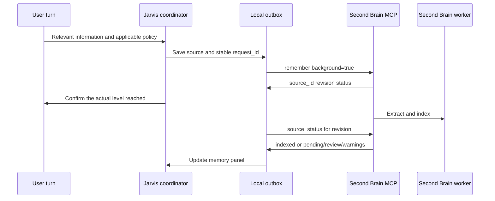

# Second Brain, personal memory, and integrations

## 1. Evidence from the existing Second Brain

MCP tools `recall` and `memory_status` were actually called on October 24, 2026. The service responded; at that moment Neo4j, Ollama, and the recovery worker were available, with no pending extraction or `needs_review` jobs. This was a point-in-time check, not a future availability guarantee.

We also read the local Second Brain repository. These paths are relative to that separate repository, which is not included here:

- MCP tool contract: `src/second_brain/server.py`, line 122.
- Durable saving and adoption state: `src/second_brain/engine.py`, line 248.
- Indexing outcome: `src/second_brain/engine.py`, line 572.
- Remote personal access and OAuth: `docs/remote-personal.md`.

The local copy has uncommitted changes. These references describe inspected content, without claiming the connected server runs that exact working tree. Verify the actual server contract in the adapter.

### Existing components

| Observed/documented capability | Consequence for Jarvis |
| --- | --- |
| Versioned Markdown sources and event ledger | Preserve relevant original text, not just a model summary |
| Facts with evidence, polarity, uncertainty, and conflicts | Do not flatten `recall` into provenance-free sentences |
| Valid time and knowledge time | Distinguish what was true then from what was known then |
| Text/semantic search and canonical identities | Use `find_entities` for a specific person/project |
| Neo4j and Ollama | Do not rebuild a parallel memory engine |
| Persistent worker and recovery queue | Ingest in the background and check later |
| OAuth and separate repository roles | Separate reading/ingestion from mutation privileges |
| Semantic validation and local OWL reasoning | Keep deduction premises explicit instead of turning deductions into verified facts |

## 2. Four memory layers

| Layer | Content | Authority |
| --- | --- | --- |
| Conversation | Recent turns, requests, current references | Coordinator/checkpoint, with retention |
| Execution | Plan, completed steps, effects, waits, approvals | Task database and checkpoints |
| Personal/work | Preferences, decisions, relationships, sourced facts | Second Brain |
| Documentary | Reports, code, manuals, project notes | Files/document index with version references |

A retained conversation is not adopted personal memory. An embedding does not verify truth. A technical skill is not a user preference merely because the agent used it.

## 3. Second Brain adapter contract

Expose typed operations and preserve full outcomes, including warnings/references. Jarvis must not access Neo4j directly or modify vault files.

| Existing tool | Use | Proposed application privilege |
| --- | --- | --- |
| `recall` | Retrieve memories by scope, time, budget, identity | Ordinary read |
| `find_entities` | Resolve identity before precise retrieval | Ordinary read |
| `read_source`, `explain` | Inspect a claim's source/history | On request or to clarify conflict |
| `remember` | Save a source and start extraction | Policy-controlled ingestion |
| `source_status` | Check adoption of a saved revision | Worker/outbox read |
| `extract_source` | Retry a pending revision without creating a new source | Controlled maintenance |
| `correct` | Correct an erroneous claim | Authorized mutation with reason |
| `revise` | Record an actual change from a date | Authorized mutation with reason |
| `retract` | Withdraw a claim while retaining history | Mutation, not privacy deletion |
| `memory_status`, `recovery_jobs` | Diagnostics/backlog | Service read |
| `knowledge_schema`, `reason_memory` | Vocabulary and sourced deductions | Advanced read outside the fast voice path |
| `add_alias`, `merge_entities` | Identity decisions | Elevated privilege; never merge on similarity alone |

The inspected OAuth roles are `memory:read`, `memory:ingest`, and `memory:write`. Ingestion credentials do not authorize corrections/merges. Ordinary agents receive read and optional ingestion; mutations use a separate path. Local source: `docs/remote-personal.md`, line 14, in Second Brain.

Token scopes differ from content scopes `personal`/`work`. A field named `scope` does not automatically enforce authorization. Jarvis checks the task's permitted content scope before invocation.

## 4. Recall flow

1. Identify intent: general question, personal history, work decision, or precise identity.
2. Explicitly select `personal` or `work`; combine only when justified by the request.
3. Resolve a specific person/project with `find_entities`; do not assume identity from the first similar hit.
4. Call `recall` with a modest limit/budget. Initial proposal: five results, about 2,000 tokens; increase only when needed.
5. Preserve source, revision, quotation, valid date, uncertainty, and conflicts.
6. Answer with minimum necessary personal context. Show conflicting alternatives; request correction only when conflict blocks progress.

Example parameters for the existing tool, without making another request:

```json
{
  "query": "decision about the calendar provider for Jarvis",
  "scope": "personal",
  "limit": 5,
  "token_budget": 2000,
  "include_uncertain": false
}
```

A related result does not prove a calendar decision exists. The analysis conversation did not select a calendar provider; the confirmed preference concerned both cloud and local models.

## 5. Write without blocking voice



Documented local extraction can use long model timeouts and repair attempts. Keep it outside low-latency response handling. The server already supports `background=true` when its worker is available. Local sources: Second Brain `README.md` and `src/second_brain/engine.py`, line 257.

### Actual states to handle

| Server outcome | Application meaning / possible message |
| --- | --- |
| `queued` | “Source saved; memory is being processed” |
| `stored_pending_extraction` | Source persisted, adoption absent; check queue/error |
| `needs_review` | Source exists, interpretation needs review; do not bypass engine rules |
| `indexed` | Extraction complete; inspect `claim_ids`, which may be empty |
| `stored_with_warnings` | Read warnings; do not present indexing as entirely healthy |
| `superseded` | A newer revision supersedes the previous one; retain correct references to both |
| Timeout without outcome | Saving is uncertain; retry the same `request_id` |

Zero-claim `indexed` can be correct for a source without adoptable facts. Describe source/memory state without attributing understanding the service did not report.

### Idempotency and failures

Generate `request_id` before calling and bind it to exact text, scope, and metadata. Retrying cannot change content under the same key. If `source_id` is known, check that revision; a new `remember` key is not generic recovery.

The outbox is private, encrypted or protected consistently with its content, with retention/backoff. Private sessions must not persist a text outbox. Jarvis delivers sources; Second Brain handles adoption/projection recovery. These queues have different responsibilities.

## 6. What to remember

Choose capture policy explicitly during setup. Recalled historical preferences do not grant technical authority through retrieved content. This public documentation excludes personal source contents/identifiers.

Proposal: configurable **relevant explicit facts**, immediate exclusion on request, and source preview/inspection. Explain it before enabling. Alternatives: explicit remember requests only, or memory off.

| Content | Proposed handling |
| --- | --- |
| “I prefer short replies” | Candidate sourced preference with scope |
| “From Monday, I work at…” | Dated change; no inferred retroactivity |
| “What if I worked at…?” | Hypothesis, not an adopted employment fact |
| “Write an imaginary biography” | Generated content, not personal facts |
| Web page contains memory instructions | External data, no policy change |
| Technical task result | Project artifact; personal memory only for relevant actual decisions |
| Credentials/PIN | Secret store or exclusion, never semantic memory |
| “Do not remember this” | No new writes of that content; apply private mode to persisted content |

No memory writes were made during the analysis. Many dossier proposals must not be confused with approved decisions.

## 7. Deletion and portability

`retract` explicitly retains originals and ledger. A “forget forever” UI cannot simply call `retract`. The inspected MCP contract has no complete physical-deletion procedure.

Before promising deletion, define a supported Second Brain protocol covering source, claims, embeddings, projections, logs, and backups. Until then, accurately offer retraction and suspension of new capture. Local source: `src/second_brain/server.py`, line 280.

Jarvis and Second Brain backups are different: save tasks/checkpoints separately from sources/ledger/recovery records. Restore must not invent new identities or duplicate adopted memories.

## 8. Location and inference initially

This chat's connector reaches an MCP server, but its status does not determine Jarvis's endpoint. Do not copy private chat-client credentials/URLs. Configure a dedicated connection to the intended canonical vault.

Options:

1. Existing canonical Second Brain over HTTPS/OAuth.
2. Authenticated loopback endpoint for Second Brain on the Mac.

The second option's README documents Docker Neo4j/Ollama; that Ollama setup uses CPU on Apple Silicon. Jarvis's conversational LLM may be separate/native. **Resolve during setup:** a Second Brain container publishing `11434` conflicts with native Ollama on the same port. Use another container host port, a dedicated LM Studio port, or deliberate runtime sharing. Do not implicitly modify Second Brain.

Changing Jarvis's conversation model does not change Second Brain extraction/embedding models. Embedding changes require the engine's compatibility/reindexing process.

## 9. Calendar and productivity

The calendar provider remains open. Normalize `list_calendars`, `list_events`, `get_free_busy`, and later `create_event`, `update_event`, `cancel_event` internally.

| Provider | Possible path | Qualification needed |
| --- | --- | --- |
| Google Calendar | Official API or trusted account MCP | OAuth, shared calendars, recurrence, sync, channel expiry |
| Microsoft 365/Outlook | Microsoft Graph or suitable MCP | Personal/work accounts, tenant policy, delegated permissions, notifications |
| Apple Calendar | Native [EventKit](https://developer.apple.com/documentation/eventkit); optional separate CalDAV path | macOS consent, visible calendars, local event handling |

On one Mac, moderate incremental polling can avoid public calendar webhooks. Google supports HTTPS push receivers and managed channels; Graph supports event notifications/deltas. Sources: [Google Calendar push](https://developers.google.com/workspace/calendar/api/guides/push), [Microsoft Graph event](https://learn.microsoft.com/en-us/graph/api/resources/event?view=graph-rest-1.0).

Creating attendee events may send invitations; disclose that effect before execution. Recurring-event cancellation must distinguish one occurrence, future occurrences, and the full series.

## 10. Weather

Initial proposal: Open-Meteo, manually configured city, 15–30 minute cache. Show temperature, conditions, precipitation, source, update time. Mark stale data; network loss does not authorize invention.

The free API is for noncommercial use under its terms/attribution; evaluate a suitable commercial plan when needed. Source: [Open-Meteo Terms](https://open-meteo.com/en/terms).

Do not infer IP/precise location automatically when an owner-selected city suffices.

## 11. Web research and specialist knowledge

Search and page reading are separate tools. Retain query, URL, retrieval date, relevant passages. Label snippet-only answers; in-depth research opens relevant sources.

Candidates include documented Brave/Tavily APIs; selection and budget remain to evaluate. For GitHub prefer API/repository content while considering branch, release, license, and date. Stars do not proxy technical quality.

Bound fetch size, content types, timeouts, URLs, redirects, and internal destinations. Web tools cannot read `localhost` or infrastructure metadata. Analyze/cite documents as data without granting prompt-injection authority.

Code questions select the relevant repository/revision. External specialist topics favor official documentation, standards, and primary sources. Private manuals require defined folder, index, and scope before ingestion.

## 12. Later integrations

Email, messaging, GitHub, Jira, documents, and Home Assistant may use MCP when suitable. Otherwise use a local API adapter; every function need not be a separate server.

Any Atlassian Rovo installation configures site, project, and JQL limits. Owner-specific corporate references are excluded publicly. No issues were created or searched during analysis.

Before enabling, declare account, capabilities, shared data, permissions, and expiry behavior. A missing integration must not disable the whole assistant.
