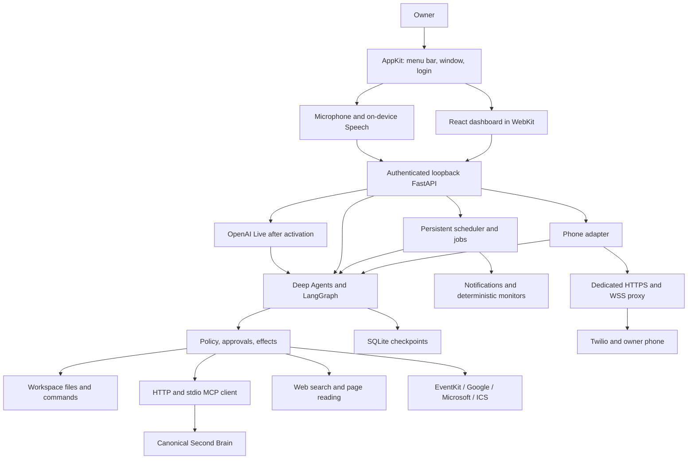

# Implementation, verification, and operations

Version 0.1.0, initially October 24, 2026; language/branding update October 25. This describes implemented code; chapters 01–09 preserve initial analysis/proposals. The catalog is a product baseline, not 132 already-passed tests.

## Implemented system

The native host owns audio, permissions, Apple Calendar, and Python supervision. No Tauri, Electron, Pipecat, or LiveKit dependency was introduced. Deep Agents provides the requested agent framework with LangGraph, explicit planning, typed tools, and durable checkpoints.

Framework files are a virtual scratchpad. Real disk files require `workspace_*`, avoiding confusion between agent state and actual file edits. Dedicated/specialist tools use the application gateway.

## Request path

1. Text arrives from dashboard, CLI, or voice. Pre-wake desktop transcription stays in the native process.
2. Create a task with profile, scope, channel, explicit authority; snapshot model/main parameters. Each request has an independent checkpoint, bounded parallel execution, and history excluding requests started later.
3. Deep Agents interprets the goal and calls schema-validated tools. Files, personal memory, web, and calendar have separate adapters.
4. A required decision interrupts the graph. Show action/arguments; bind approval to their hash and expiry. Model prose is not approval.
5. Atomically claim effects in SQLite with stable keys. Identical concurrent calls execute a mutation once. Mutation timeout leaves `unknown`; the owner checks the original system and records the outcome.
6. Keep final answer, events, results available. Spoken summaries omit code/raw URLs without adding text in another language. Interrupting speech does not cancel work.

`approval` commands run on the host with a minimal environment after approval. `sandbox` uses macOS filesystem/network confinement, tested with Python, an excluded file, and denied network access. Other toolchains may need additional rules. There is no sandbox-to-host fallback.

Dashboard/voice deliveries include a stable request ID. Repeating delivery retrieves the original task; reusing the ID with different arguments is rejected. Lost HTTP responses cannot restart accepted actions. Private requests whose RAM content was lost on restart require explicit new input.

## Model compatibility checks

Select an installed model with structured tool support. Verify a real `current_time` tool call, then a temporary workspace read/write and an explicitly approved verification command. Model catalog metadata alone does not prove compatibility. Keep model inventories, hardware measurements, and personal integration outcomes in private local records.

## Weather forecasts

The `weather` tool provides current conditions and daily forecasts, with seven days starting
today by default. Optional `days` (1–16) and ISO `start_date` select a specific period. The
forecast API covers today and the following 15 days in the configured time zone; a later
date can still trigger public web research rather than an immediate capability refusal.
Relative dates such as tomorrow or the weekend are resolved using `current_time`. The
agent uses `daily.time` and the corresponding forecast values, separately from `current`.

Daily results include minimum/maximum temperature, weather code, precipitation probability
and amount, wind, units, and actual coverage. Partial results, null values, expired cached
data, and requests beyond the horizon must not become invented forecasts. Routine weather
requests continue without dashboard approval and without mandatory spoken citations.

The provider's complete daily horizon is cached once per location, local day, and time zone;
only requested dates enter the tool result. Current conditions remain compatible with the
dashboard. A stale fallback retains the requested dates and an explicit freshness flag.
No unused hourly arrays are requested. The horizon and daily variables follow the
[Open-Meteo forecast API](https://open-meteo.com/en/docs).

`tests/test_weather_forecast.py` covers future-date selection, cache reuse and midnight/time
zone changes, invalid/out-of-range arguments before any network request, partial/malformed
provider data, stale fallback, strict offline mode, and ongoing text/live task permissions.
Fixtures are synthetic and never use a personal location or paid model.

## Tool recovery and web research

Text and voice share a recovery policy: a failed, empty, incomplete, or stale read is not
an immediate reason to stop. Correct invalid arguments, use another suitable authorized
source, and research public facts with `web_search` and `read_web_page` before reporting
that the information remains unavailable. Private memories, calendars, files, account
permissions, and uncertain mutations cannot be replaced by a public search.

Read-only network failures produce sanitized, recoverable tool outcomes rather than
aborting the entire agent task. MCP discovery failure explicitly means no operation has
started; an uncertain MCP write keeps its effect ledger and is never silently replayed.
Raw provider errors and credentials are not included in public lookup queries.

Weather has a deterministic recovery path. Its adapter validates the place, date, and
length and constructs a public query using only the place label and requested dates.
Unavailability, partial coverage, stale fallback, and entirely missing forecast values
trigger one search and parallel reads of at most three result pages. Up to two page
excerpts enter the evidence. The primary result and `web_recovery` remain separate.
When an otherwise successful result lacks a requested detail, the agent can use
`public_web_query`, optionally adding one fixed weather focus: hourly, humidity, rain,
wind, snow, or temperature. Exact query grants and resulting public URLs avoid redundant
approvals without permitting private content to become another query or URL.

At most two distinct queries per validated weather topic are attempted in a task, with
task-local deduplication of repeated searches/recovery. Read/search/page stages have
bounded timeouts within the tool budget. The keyless DuckDuckGo provider tries its Lite
entry point once if HTML returns no usable results; it does not silently change provider.
Successful complete tools do not trigger extra web requests. Coordinates without a
configured place label are not copied into public search. Grants/caches stay in task RAM.

Sources must match the requested location/date and actually supply the needed fact.
Snippets, seasonal averages, old articles, missing values, and unsupported exact forecasts
must not be presented as verified future observations. If alternate sources also fail,
Jarvis explains what was tried and what remains unknown. Routine weather does not need
mandatory spoken provider names. Offline mode, emergency stop, denied permissions, and
private-data export controls remain authoritative.

`tests/test_web_recovery.py` covers the recovery chain, timeouts, focused queries and
budgets, deduplication, HTML/Lite parsing, failure of both sources, MCP read/write outcomes,
scope/egress protections, and ongoing text/live conversations with synthetic evidence.

## Memory and authentication

Use the existing Second Brain without modifying its repository, vault, or database. Implemented operations include `recall`, `remember`, `source_status`, `read_source`, `correct`, `revise`, `retract` according to the inspected contract.

Calendar refresh-token rotations are cached privately against account/initial token, including env/Keychain-provided initial values.

The ingestion queue preserves original source and `request_id`; timeout does not generate another ID. Check adoption through `source_status`, distinguishing `pending`, `queued`, `stored_pending_extraction`, `indexed`, `needs_review`, `stored_with_warnings`, `superseded`. Retry does not force rejected/uncertain adoption.

Explicit scopes are `personal`/`work`. `memory_remember` only accepts a source contained in the original user request, not generated biography. Default policy captures explicit remember requests; English/Italian opt-out is enforced in the tool too.

Initial OAuth requests read/ingest according to the server contract; corrections/retractions require a separate option/`memory:write` consent. The owner's existing dedicated read connection has been restored and verified without new writes. Jarvis credentials remain separate from development-chat credentials.

Use the canonical endpoint announced in server OAuth metadata. Correct audience rejection of a loopback endpoint advertising a tunneled HTTPS resource is not bypassed. Configure the dedicated connection against the announced resource.

Explicitly requested files can still be changed in private sessions: privacy controls dialogue history, not the persistence of requested files/effects.

Private sessions use in-memory checkpoints, exclude persistent messages/results, and prohibit new memory writes. Keep at most 64 completed private tasks in RAM and recent available turns as context. Persist empty content metadata only. This does not promise remote-provider retention behavior. Ordinary retention also clears completed task/checkpoint content, without undoing external effects/files.

## Voice, presence, and phone

The native host provides menu bar, optional launch at login, ⌘⇧J, dashboard. Distinguish login registration from macOS approval under [SMAppService](https://developer.apple.com/documentation/servicemanagement/smappservice/register()). Closing hides the window. “Quit Jarvis” stops the host and its owned service; separately launched CLI backends retain their own lifecycle.

Dashboard privacy/scope also apply to desktop voice, shortcut, wake phrase. Store these preferences separately from content, synchronize/version them across clients, and reject stale-client submissions until refreshed. Changing them separates context. Phone sessions are distinct.

Open the microphone after consent. Apple Speech must support on-device recognition in the selected locale; otherwise show unavailable without cloud fallback. Wake detection matches local transcript word boundaries; it is not a custom-trained acoustic detector. With OpenAI Live, audio conversation begins only after activation.

Orb levels come from actual capture/playback buffers; processing animation is a separate state. Mute releases capture and persists. Lock normally suspends listening. Real-device testing is still needed for false triggers, noise, headphones, echo, switching, prolonged consumption, sleep/wake.

Separate silence (`kAFAssistantErrorDomain:1110`) from service failure. Silence renews sessions; transient interruptions use bounded exponential delays. Missing models, disabled Dictation, and denied authorization have specific domain/code diagnostics. Invalidate cancelled-session callbacks before replacement. Classification: [Apple Speech errors](https://developer.apple.com/documentation/speech/sfspeechrecognitiontask/error?language=objc).

Capture uses the hardware microphone stream. Forcing VoiceProcessingIO on a graph separate from playback produced repeated Core Audio downlink errors on the test Mac, so it is not forced. Diagnostics distinguish input buffers, recognizer callbacks, and wake matches without pre-activation transcripts.

An Apple Silicon MacBook physically disconnects its built-in microphone with the lid closed. Permission and a running audio engine do not establish usable input. Open the lid or choose external input; reactivate after device changes. This occurs before transcription/model invocation. Source: [Apple hardware microphone disconnect](https://support.apple.com/en-gb/guide/security/secbbd20b00b/1/web/1).

The phone adapter implements:

- Outbound calls only to the configured owner, event deduplication, one automatic attempt.
- Request signatures, Call SID verification, bounded PIN attempts, one-use media tokens.
- Mono 8 kHz μ-law, turn detection, audio-queue interruption.
- OpenAI or optional faster-whisper STT; OpenAI TTS or locally converted system voice.
- Call reason/conversation context after authentication.
- Exact gateway proposal readback with DTMF 1/2; long proposals require dashboard review.
- Max duration, quiet hours, daily reservation, uncertain-outcome reconciliation.

This path recognizes a turn, waits for the agent, and synthesizes an answer over bidirectional audio. It is not native provider speech-to-speech; no unmeasured latency claim. No real line, voicemail, or carrier billing was tested without the phone account.

Optional inbound calling requires carrier voice/status webhooks. Reserve rounded minutes plus inbound PIN tolerance; daily window is UTC. Preload local STT models before calls; do not download during a call. Audio keys are dedicated, not implicitly copied from LLM keys. STT no longer forces Italian, while fixed service/authentication messages are English.

`scripts/Caddyfile.telephony.example` exposes only phone routes. Never publish the local API, GUI, or token. Sleep/shutdown interrupt availability; no hidden server was added.

## Completed verification

| Area | Evidence |
| --- | --- |
| Automated tests | 72 Python cases covering authentication, Origin/Host, size limits, redaction, env precedence, symlinks, file revisions, process environment, timeouts, sandbox, memory, scheduler, actual Deep Agents with a scripted model, budget, voice privacy, telephony, language policy, language-preserving spoken summaries |
| Swift regressions | 31 scenarios: silence/recovery/backoff/setup/permissions/nested errors/private diagnostics, bounded PCM/session cleanup, Italian/English system-voice selection, continuous resampling, end-of-stream flushing and playback prebuffering; `scripts/test-native.sh` |
| Persistence | Approval/checkpoint survive service recreation; resume does not duplicate effects |
| Concurrency | Ten identical concurrent calls yield one mutation; five same-ID deliveries yield one task |
| Memory | Simulated timeout after remote commit retains `request_id`; separate adoption, opt-out/private checks |
| MCP | FastMCP discovery/structured results, real stdio process with explicit environment excluding provider keys |
| Calendar | ICS RRULE/EXDATE/RECURRENCE-ID; Microsoft date conversion to UTC |
| Phone | Signatures/PIN, out-of-order callbacks, μ-law, ambiguous timeout without second ring, proposal-bound DTMF; mocked carrier/cloud audio |
| Local audio | Earlier real Mac synthesis and μ-law conversion produced actual bytes |
| Local model | Tool execution and Python read/write/verification in an isolated temporary workspace |
| Web | Open-Meteo test-city weather, three DuckDuckGo results, actual LangChain page content |
| GUI | Real chat; routine create/pause/resume/delete; tasks/memory/connections; light/dark; 390 px without horizontal overflow; privacy/scope sync across two windows/reloads |
| Mac | Ad-hoc build/signature; bundle startup and child backend heartbeat; supervised backend restart |
| Branding | Original SVG rendered into standard/Retina ICNS, bundle resource/declaration, shared dashboard/favicon identity |

JUnit: `output/pytest.xml`; screenshots: `output/playwright/`. Scripted-model tests verify contracts, interruption, framework execution—not a real cloud provider's language accuracy. Real multilingual audio/acoustic validation remains distinct.

## Requirements coverage and remaining checks

| Catalog group | Implemented | Verification limit |
| --- | --- | --- |
| PR, CV | Background host, permissions, voice, mute, turns, playback, recovery | Exercise wake/audio/login/sleep with actual devices/consent |
| IN, TL | Routing/env, Deep Agents, checkpoints, MCP schemas, policy, deduplication | Other providers/personal MCP accounts need credentials; each model needs compatibility tests |
| RS, CD | Search, web reader, files, diff, commands, sandbox, artifacts | Verify each project toolchain; one task does not certify general model quality |
| TK, NT | Persistent routines, JSON monitors, misfires, notifications, explicit escalation, pause/cancel | Observe OS/carrier delivery/network separately from local records |
| ME | Sourced/revisioned recall, outbox/adoption, corrections, scope, opt-out | Real writes require appropriate consent and a safe test source; no existing memories altered |
| PH | Carrier/media, identity, PIN, DTMF, policy, reservation, reconciliation | Real calls, interruptions, latency, voicemail, tunnel availability remain |
| PD | Weather, Apple/Google/Microsoft/ICS adapters | Personal calendar/account authorization remains |
| UI, CF | Dashboard/menu bar, text/timeline, approval, themes, env/audit, emergency stop | Dedicated VoiceOver, contrast, assistive-technology validation remains |

Integrated encrypted backup, signed updater, mobile app, biometric speaker verification, home automation, universal desktop automation, and server deployment are not claimed implemented. Authorized MCP tools can extend some capabilities. Third-party actions retain service policy/account consent requirements.

## Everyday operations

- Open the bundle and grant desired permissions. Enable “Launch at login” for presence after login; macOS may require Login Items approval.
- Use `jarvis doctor` to distinguish runtime, backend, native host, memory, phone. Missing integrations do not block the core.
- After env/source updates, quit/reopen. Stop separately launched CLI services too. Only one API owns a data directory.
- Launch the native bundle through macOS Launch Services (`open dist/Jarvis.app --args --show`), not by executing its `Contents/MacOS/Jarvis` binary from an IDE or Python subprocess. Direct execution can attribute TCC permission requests to the development host, causing a missing-usage-description termination even when the app's plist is valid. Ad-hoc rebuilds can require microphone/speech consent again; complete OS dialogs after unlocking the Mac.
- For `unknown` effects, check the original system before recording executed/not executed. Check carrier logs before retrying calls.
- Emergency stop blocks new tasks/tools/audio, cancels pending decisions, and attempts to close known calls. Already-sent operations may need reconciliation.
- For consistent manual backup, stop the service and copy private data/`.env` to protected storage. Keychain and Second Brain vault are separate; copying Jarvis data does not replace them.

This local bundle depends on the project path. Distribution requires embedded runtimes, Developer ID signing, notarization, verified updates, and testing on other Macs. These follow the local implementation.

Desktop OpenAI Live and verification status are in [chapter 13](13-voce-openai.md).
