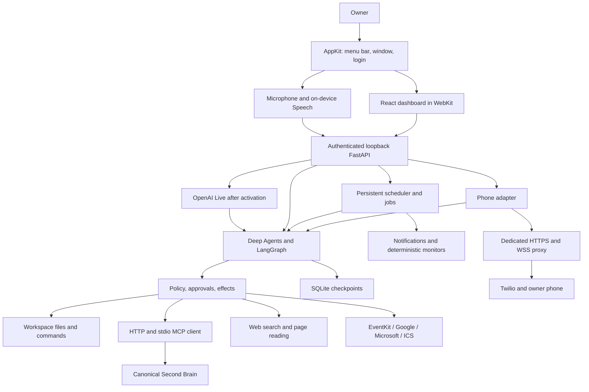

# Implementation, verification, and operations

Version 0.1.0; updated November 3, 2026. This chapter describes shared/local
runtime operations and the remote extension. The original catalog is a
132-requirement baseline, not 132 passed tests. Current modes, feature coverage and
rerun totals are in [chapter 33](33-current-state-and-verification.md).

## Local native runtime

The local native host owns audio, permissions, Apple Calendar and Python
supervision, using AppKit/WebKit rather than Tauri/Electron. The separate remote
desktop companion now uses Electron, and mobile uses Capacitor. Pipecat/LiveKit
remain research alternatives. Deep Agents supplies LangGraph, explicit planning,
typed tools and durable checkpoints in both modes.

## Remote core and expanded assistant

The [current architecture](03-architettura.md) adds one server authority,
device/session authentication, filtered event polling, administrator settings,
outbound-WSS desktop dispatch, an isolated parser and push outbox. The core uses
cloud models and disables host commands/workspaces/native voice and stdio MCP.
Local mode remains independent; it does not synchronize its database or take over
when the remote core is offline.

Today/briefings, projects/activities, mail/drafts, event automations, documents/OCR,
chosen-window context, Jira/GitHub and Home Assistant are implemented and exposed
through shared views/tools. Read [feature setup](29-assistant-setup.md),
[server operations](../deploy/README.md) and [companion enrollment](../companions/README.md).
Server sources need independent reachability; Mac files/EventKit/window capture
need their granted executor. Directory rules inspect the core host, not the desktop.

Remote private data belongs to a client session; ordinary conversations can be
continued across devices in the same scope. The local bearer/native bridge is
denied remotely. Companion STT/review/TTS is distinct from native Live and carrier
audio. Remote settings use revision checks; old saves return HTTP 409.

Framework files are a virtual scratchpad. Real local-core disk files require
`workspace_*`; paired desktop files use `device_*` and local executor grants.
Remote mode has no core-host workspace by default. Dedicated/specialist tools
use the application gateway.

## Request path

1. Text arrives from dashboard, CLI, or voice. Pre-wake desktop transcription stays in the native process.
2. Create a task with profile, scope, channel, explicit authority; snapshot model/main parameters. Each request has an independent checkpoint, bounded parallel execution, and history excluding requests started later.
3. Deep Agents interprets the goal and calls schema-validated tools. Files, personal memory, web, and calendar have separate adapters.
4. A required decision interrupts the graph. Show action/arguments; bind approval to their hash and expiry. Model prose is not approval.
5. Atomically claim effects in SQLite with stable keys. Identical concurrent calls execute a mutation once. Mutation timeout leaves `unknown`; the owner checks the original system and records the outcome.
6. Keep final answer, events, results available. Spoken summaries omit code/raw URLs without adding text in another language. Interrupting speech does not cancel work.

`approval` commands run on the host with a minimal environment after approval. `sandbox` uses macOS filesystem/network confinement, tested with Python, an excluded file, and denied network access. Other toolchains may need additional rules. There is no sandbox-to-host fallback.

Dashboard/voice deliveries include a stable request ID. Repeating delivery retrieves the original task; reusing the ID with different arguments is rejected. Lost HTTP responses cannot restart accepted actions. Private requests whose RAM content was lost on restart require explicit new input.

## Model compatibility checks

Select an installed model with structured tool support. Verify a real `current_time` tool call, then a temporary workspace read/write and an explicitly approved verification command. Model catalog metadata alone does not prove compatibility. Keep model inventories, hardware measurements, and personal integration outcomes in private local records.

## Weather forecasts

The `weather` tool provides current conditions and daily forecasts, with seven days starting
today by default. Optional `days` (1–16) and ISO `start_date` select a specific period. The
forecast API covers today and the following 15 days in the configured time zone; a later
date can still trigger public web research rather than an immediate capability refusal.
Relative dates such as tomorrow or the weekend are resolved using `current_time`. The
agent uses `daily.time` and the corresponding forecast values, separately from `current`.

Daily results include minimum/maximum temperature, weather code, precipitation probability
and amount, wind, units, and actual coverage. Partial results, null values, expired cached
data, and requests beyond the horizon must not become invented forecasts. Routine weather
requests continue without dashboard approval and without mandatory spoken citations.

The provider's complete daily horizon is cached once per location, local day, and time zone;
only requested dates enter the tool result. Current conditions remain compatible with the
dashboard. A stale fallback retains the requested dates and an explicit freshness flag.
No unused hourly arrays are requested. The horizon and daily variables follow the
[Open-Meteo forecast API](https://open-meteo.com/en/docs).

`tests/test_weather_forecast.py` covers future-date selection, cache reuse and midnight/time
zone changes, invalid/out-of-range arguments before any network request, partial/malformed
provider data, stale fallback, strict offline mode, and ongoing text/live task permissions.
Fixtures are synthetic and never use a personal location or paid model.

## Tool recovery and web research

Text and voice share a recovery policy: a failed, empty, incomplete, or stale read is not
an immediate reason to stop. Correct invalid arguments, use another suitable authorized
source, and research public facts with `web_search` and `read_web_page` before reporting
that the information remains unavailable. Private memories, calendars, files, account
permissions, and uncertain mutations cannot be replaced by a public search.

Read-only network failures produce sanitized, recoverable tool outcomes rather than
aborting the entire agent task. MCP discovery failure explicitly means no operation has
started; an uncertain MCP write keeps its effect ledger and is never silently replayed.
Raw provider errors and credentials are not included in public lookup queries.

Weather has a deterministic recovery path. Its adapter validates the place, date, and
length and constructs a public query using only the place label and requested dates.
Unavailability, partial coverage, stale fallback, and entirely missing forecast values
trigger one search and parallel reads of at most three result pages. Up to two page
excerpts enter the evidence. The primary result and `web_recovery` remain separate.
When an otherwise successful result lacks a requested detail, the agent can use
`public_web_query`, optionally adding one fixed weather focus: hourly, humidity, rain,
wind, snow, or temperature. Exact query grants and resulting public URLs avoid redundant
approvals without permitting private content to become another query or URL.

At most two distinct queries per validated weather topic are attempted in a task, with
task-local deduplication of repeated searches/recovery. Read/search/page stages have
bounded timeouts within the tool budget. The keyless DuckDuckGo provider tries its Lite
entry point once if HTML returns no usable results; it does not silently change provider.
Successful complete tools do not trigger extra web requests. Coordinates without a
configured place label are not copied into public search. Grants/caches stay in task RAM.

Sources must match the requested location/date and actually supply the needed fact.
Snippets, seasonal averages, old articles, missing values, and unsupported exact forecasts
must not be presented as verified future observations. If alternate sources also fail,
Jarvis explains what was tried and what remains unknown. Routine weather does not need
mandatory spoken provider names. Offline mode, emergency stop, denied permissions, and
private-data export controls remain authoritative.

`tests/test_web_recovery.py` covers the recovery chain, timeouts, focused queries and
budgets, deduplication, HTML/Lite parsing, failure of both sources, MCP read/write outcomes,
scope/egress protections, and ongoing text/live conversations with synthetic evidence.

## Memory and authentication

Use the existing Second Brain without modifying its repository, vault, or database. Implemented operations include `recall`, `remember`, `source_status`, `read_source`, `correct`, `revise`, `retract` according to the inspected contract.

Calendar refresh-token rotations are cached privately against account/initial token, including env/Keychain-provided initial values.

The ingestion queue preserves original source and `request_id`; timeout does not generate another ID. Check adoption through `source_status`, distinguishing `pending`, `queued`, `stored_pending_extraction`, `indexed`, `needs_review`, `stored_with_warnings`, `superseded`. Retry does not force rejected/uncertain adoption.

Explicit scopes are `personal`/`work`. `memory_remember` only accepts a source contained in the original user request, not generated biography. Default policy captures explicit remember requests; English/Italian opt-out is enforced in the tool too.

Initial OAuth requests read/ingest according to the server contract;
corrections/retractions require a separate option/`memory:write` consent.
Jarvis credentials remain separate from development-chat credentials. Personal
connection outcomes belong in private records, not a claim of account acceptance
from the synthetic regression suite.

Use the canonical endpoint announced in server OAuth metadata. Correct audience rejection of a loopback endpoint advertising a tunneled HTTPS resource is not bypassed. Configure the dedicated connection against the announced resource.

Explicitly requested files can still be changed in private sessions: privacy controls dialogue history, not the persistence of requested files/effects.

Private sessions use in-memory checkpoints, exclude persistent messages/results, and prohibit new memory writes. Keep at most 64 completed private tasks in RAM and recent available turns as context. Persist empty content metadata only. This does not promise remote-provider retention behavior. Ordinary retention also clears completed task/checkpoint content, without undoing external effects/files.

## Voice, presence, and phone

The native host provides menu bar, optional launch at login, ⌘⇧J, dashboard. Distinguish login registration from macOS approval under [SMAppService](https://developer.apple.com/documentation/servicemanagement/smappservice/register()). Closing hides the window. “Quit Jarvis” stops the host and its owned service; separately launched CLI backends retain their own lifecycle.

Dashboard privacy/scope also apply to desktop voice, shortcut, wake phrase. Store these preferences separately from content, synchronize/version them across clients, and reject stale-client submissions until refreshed. Changing them separates context. Phone sessions are distinct.

Open the microphone after consent. Apple Speech must support on-device recognition in the selected locale; otherwise show unavailable without cloud fallback. Wake detection matches local transcript word boundaries; it is not a custom-trained acoustic detector. With OpenAI Live, audio conversation begins only after activation.

Orb levels come from actual capture/playback buffers; processing animation is a separate state. Mute releases capture and persists. Lock normally suspends listening. Real-device testing is still needed for false triggers, noise, headphones, echo, switching, prolonged consumption, sleep/wake.

Separate silence (`kAFAssistantErrorDomain:1110`) from service failure. Silence renews sessions; transient interruptions use bounded exponential delays. Missing models, disabled Dictation, and denied authorization have specific domain/code diagnostics. Invalidate cancelled-session callbacks before replacement. Classification: [Apple Speech errors](https://developer.apple.com/documentation/speech/sfspeechrecognitiontask/error?language=objc).

Capture uses the hardware microphone stream. An initial separate capture-only
VoiceProcessingIO graph failed; the implemented automatic mode instead shares
capture/playback for an actual echo reference, as described in
[chapter 20](20-spoken-interruption.md). An independently selected non-default
input uses protected/manual interruption. Diagnostics distinguish input buffers,
recognizer callbacks and wake matches without pre-activation transcripts.

An Apple Silicon MacBook physically disconnects its built-in microphone with the lid closed. Permission and a running audio engine do not establish usable input. Open the lid or choose external input; reactivate after device changes. This occurs before transcription/model invocation. Source: [Apple hardware microphone disconnect](https://support.apple.com/en-gb/guide/security/secbbd20b00b/1/web/1).

The phone adapter implements:

- Outbound calls only to the configured owner, event deduplication, one automatic attempt.
- Request signatures, Call SID verification, optional PIN verification controlled by the Telephony checkbox, bounded PIN attempts when enabled, one-use media tokens.
- Mono 8 kHz μ-law, turn detection, audio-queue interruption.
- OpenAI or optional faster-whisper STT; OpenAI TTS or locally converted system voice.
- Call reason/conversation context after authentication.
- Exact gateway proposal readback with DTMF 1/2; long proposals require dashboard review.
- Max duration, quiet hours, daily reservation, uncertain-outcome reconciliation.

Before creating an outbound call, a signed challenge on `/telephony/status` proves that the configured public tunnel reaches this Jarvis instance. An expired tunnel URL fails before a carrier call or budget reservation is created. No additional public proxy routes are required.

Known Call SIDs are checked against the carrier every 30 seconds, when the call list is refreshed (throttled to 15 seconds), and before starting another call. Verified terminal states recover missed status callbacks, preserve the carrier end time, and settle the reservation using rounded actual minutes at the configured rate, or the carrier price when higher. Missing usage retains the full reservation. A lookup failure or an uncertain creation without a SID cannot clear the active-call block; manual reconciliation remains available. Carrier verification uses the SDK's `_from` field and checks the SID, numbers, direction and creation time.

The legacy path recognizes a turn, waits for the agent and synthesizes an answer
over bidirectional audio. Selecting OpenAI Live instead uses the shared native
voice/model/style through the phone Live bridge; see [chapter 14](14-audio-quality-and-voice.md#the-same-voice-on-phone-calls).
Neither path claims unmeasured latency or real-line/voicemail/billing acceptance.

Optional inbound calling requires carrier voice/status webhooks. Reserve rounded
minutes plus inbound PIN tolerance; daily window is UTC. Preload local STT models
before calls; do not download during a call. Audio keys follow their explicit
provider policy; phone Live can reuse the eligible official OpenAI desktop/text
key. STT does not force Italian. Carrier PIN prompts use the configured
Italian/English response/recognition language.

`scripts/Caddyfile.telephony.example` exposes only phone routes. Managed mode generates the same restricted routes on a free loopback port and supervises Caddy/Cloudflare from the Activate/Deactivate controls, including cleanup after shutdown or parent death. External mode retains the manually supplied proxy. See [managed telephony](26-managed-telephony.md). Never publish the local API, GUI, or token. Sleep/shutdown interrupt availability.

## Completed verification

The table below preserves the **initial local implementation** evidence. Its
72-case/31-scenario totals are historical. The November 3 review reran the current
Python, web, desktop bridge and native suites; see
[current results](33-current-state-and-verification.md#verification-on-november-3).
The dated assistant and remote build gates remain in chapters 27 and 32.

| Area | Evidence |
| --- | --- |
| Automated tests | 72 Python cases covering authentication, Origin/Host, size limits, redaction, env precedence, symlinks, file revisions, process environment, timeouts, sandbox, memory, scheduler, actual Deep Agents with a scripted model, budget, voice privacy, telephony, language policy, language-preserving spoken summaries |
| Swift regressions | 31 scenarios: silence/recovery/backoff/setup/permissions/nested errors/private diagnostics, bounded PCM/session cleanup, Italian/English system-voice selection, continuous resampling, end-of-stream flushing and playback prebuffering; `scripts/test-native.sh` |
| Persistence | Approval/checkpoint survive service recreation; resume does not duplicate effects |
| Concurrency | Ten identical concurrent calls yield one mutation; five same-ID deliveries yield one task |
| Memory | Simulated timeout after remote commit retains `request_id`; separate adoption, opt-out/private checks |
| MCP | FastMCP discovery/structured results, real stdio process with explicit environment excluding provider keys |
| Calendar | ICS RRULE/EXDATE/RECURRENCE-ID; Microsoft date conversion to UTC |
| Phone | Signatures/PIN, out-of-order callbacks, μ-law, ambiguous timeout without second ring, proposal-bound DTMF; mocked carrier/cloud audio |
| Local audio | Earlier real Mac synthesis and μ-law conversion produced actual bytes |
| Local model | Tool execution and Python read/write/verification in an isolated temporary workspace |
| Web | Open-Meteo test-city weather, three DuckDuckGo results, actual LangChain page content |
| GUI | Real chat; routine create/pause/resume/delete; tasks/memory/connections; light/dark; 390 px without horizontal overflow; privacy/scope sync across two windows/reloads |
| Mac | Ad-hoc build/signature; bundle startup and child backend heartbeat; supervised backend restart |
| Branding | Original SVG rendered into standard/Retina ICNS, bundle resource/declaration, shared dashboard/favicon identity |

JUnit: `output/pytest.xml`; screenshots: `output/playwright/`. Scripted-model tests verify contracts, interruption, framework execution—not a real cloud provider's language accuracy. Real multilingual audio/acoustic validation remains distinct.

## Requirements coverage and remaining checks

| Catalog group | Implemented | Verification limit |
| --- | --- | --- |
| PR, CV | Background host, permissions, voice, mute, turns, playback, recovery | Exercise wake/audio/login/sleep with actual devices/consent |
| IN, TL | Routing/env, Deep Agents, checkpoints, MCP schemas, policy, deduplication | Other providers/personal MCP accounts need credentials; each model needs compatibility tests |
| RS, CD | Search, web reader, cited documents/OCR, files/diff/commands, scoped Jira/GitHub PR/CI evidence | Verify each project toolchain/account; partial/stale evidence and OS/executor limits remain |
| TK, NT | Persistent routines, JSON monitors, misfires, notifications, explicit escalation, pause/cancel | Observe OS/carrier delivery/network separately from local records |
| ME | Sourced/revisioned recall, outbox/adoption, corrections, scope, opt-out | Real writes require appropriate consent and a safe test source; no existing memories altered |
| PH | Carrier/media, identity, PIN, DTMF, policy, reservation, reconciliation | Real calls, interruptions, latency, voicemail, tunnel availability remain |
| PD | Weather/calendar analysis, Today/briefings, projects/activities, mail/drafts and Home Assistant MCP | Personal consent, sending permission, physical readback and independently reachable providers remain |
| UI, CF | Dashboard/menu bar, text/timeline, approval, themes, env/audit, emergency stop | Dedicated VoiceOver, contrast, assistive-technology validation remains |

Encrypted age backup/restore, Home Assistant MCP, remote core deployment assets
and desktop/mobile companion source are implemented. The
[current matrix](33-current-state-and-verification.md) distinguishes them from
signing, real-device/account acceptance and actual production deployment.
A signed updater, biometric speaker verification, universal desktop automation,
automatic offline failover and server high availability remain outside delivery.

## Everyday operations

- Open the bundle and grant desired permissions. Enable “Launch at login” for presence after login; macOS may require Login Items approval.
- Use `jarvis doctor` to distinguish runtime, backend, native host, memory, phone. Missing integrations do not block the core.
- After env/source updates, quit/reopen. Stop separately launched CLI services too. Only one API owns a data directory.
- Launch the native bundle through macOS Launch Services (`open dist/Jarvis.app --args --show`), not by executing its `Contents/MacOS/Jarvis` binary from an IDE or Python subprocess. Direct execution can attribute TCC permission requests to the development host, causing a missing-usage-description termination even when the app's plist is valid. Ad-hoc rebuilds can require microphone/speech consent again; complete OS dialogs after unlocking the Mac.
- For `unknown` effects, check the original system before recording executed/not executed. Check carrier logs before retrying calls.
- Emergency stop blocks new tasks/tools/audio, cancels pending decisions, and attempts to close known calls. Already-sent operations may need reconciliation.
- For consistent manual backup, stop the service and copy private data/`.env` to protected storage. Keychain and Second Brain vault are separate; copying Jarvis data does not replace them.
- For encrypted snapshots and conservative restore, use [the age backup procedure](../deploy/README.md#backup-e-ripristino); separately protect mounted push credentials and external memory data.

This local bundle depends on the project path. Distribution requires embedded runtimes, Developer ID signing, notarization, verified updates, and testing on other Macs. These follow the local implementation.

Desktop OpenAI Live and verification status are in [chapter 13](13-voce-openai.md).
