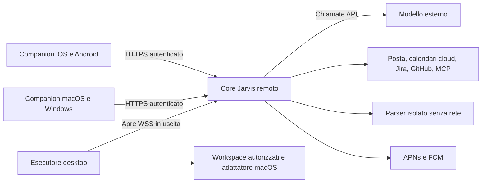

# Core remoto e companion: analisi, implementazione e verifica

3 novembre 2026. Questo documento raccoglie la discussione e aggiorna i capitoli
[28](28-companion-architecture.md), [30](30-cloud-deployment-feasibility.md) e
[31](31-remote-core-and-device-agents.md) con l'implementazione. Lo sviluppo è
autorizzato; una VM acquistata, la pubblicazione negli store e credenziali di
servizi reali restano operazioni distinte.

Revisione documentale del 3 novembre sulla sorgente `6ff2d65`: la
[matrice corrente](33-current-state-and-verification.md) raccoglie modalità,
contratti e regressione rieseguita. Le evidenze di packaging/container/browser
qui sotto sono quelle della consegna di sviluppo precedente alla revisione dei
manuali; non sono state ripetute né trasformate in una release firmata.

## Decisioni confermate

L'obiettivo è parlare con Jarvis da iPhone o Android anche a Mac spento, e poter
chiedere operazioni sul computer quando è disponibile. La scelta è **un solo
core autorevole sul server, due companion e un esecutore desktop separato**.
Desktop e mobile condividono il medesimo assistente, non due storie o scheduler
che tentano di sincronizzarsi. La modalità autonoma/offline desktop è rinviata;
l'app locale esistente continua a essere una modalità separata.

Il core custodisce conversazioni, contesto, stato dei lavori, approvazioni,
routine, budget, connessioni e configurazione del modello. Il modello esterno
ragiona attraverso API; non ospitiamo pesi di un LLM sulla VM. Il desktop esegue
solo capacità concesse localmente. Il telefono presenta la UI, acquisisce la
voce esplicita e condivide fonti scelte.

Non esiste un collegamento diretto telefono–computer. L'esecutore apre la
connessione verso il core e riceve lavori attraverso quella connessione; non
apre un server sul Mac/PC. Il telefono può chiudere l'app dopo l'accettazione di
una richiesta: il lavoro continua sul core, nei limiti delle proprie dipendenze.

## Analisi dei blocchi e sviluppo

| Blocco | Requisiti e scelta sviluppata | Verifica significativa |
|---|---|---|
| Autorità remota | FastAPI/LangGraph esistenti, nuovo comando `jarvis server`, singola autorità SQLite/scheduler, modelli API | Regressione del motore e prova Linux nei container |
| Identità | Codice monouso, ruoli companion/amministratore/esecutore, token brevi e refresh ruotato | Scadenza, replay, revoca e credenziali locali rifiutate |
| Sessioni | Contesto per dispositivo e conversazione, scope personale/lavoro e privacy separati | Richieste iniziali parallele, dispositivi distinti, task/allegati/approvazioni privati |
| Esecutore | WSS avviata dal desktop, grant locali, scadenze e registro degli effetti | WebSocket reale, lettura autorizzata, scrittura con hash, duplicati e riavvio |
| Capacità macOS | Helper EventKit/ScreenCaptureKit, grant e selezione della finestra sul Mac | Helper compilato, stato reale, test dei grant; consenso TCC reale ancora da provare con build firmata |
| Companion desktop | UI React comune in Electron, sandbox renderer, IPC ristretto, vault del sistema, tray e login | Avvio reale macOS, screenshot, pacchetti DMG/ZIP; builder Windows in CI |
| Companion mobile | UI adattata al telefono in Capacitor, Keychain/Keystore, microfono e share target nativi | Build iOS simulatore con estensione, APK Android e lint |
| Voce | PCM WAV canonico, STT, revisione, invio esplicito e TTS opzionale, budget | Input malformati rifiutati prima del provider; chiamata SDK simulata senza retry |
| Push | APNs e FCM dal core, token cifrati, outbox, retry limitati, payload generico | Firma ES256, HTTP provider simulato, associazione piattaforma/dispositivo e revoca |
| Integrazioni | Jira/GitHub e HA esistenti sul core, OAuth pubblico con consenso dalla companion | Handler effettivi SDK, stato monouso e dispositivo iniziatore; regressione integrazioni |
| Documenti | Broker Unix e processo parser in container senza rete né dati del core | Parsing reale, limiti del protocollo e ambiente senza credenziali |
| Distribuzione | Docker, Compose, Caddy HTTPS, volumi privati, backup age | Container non root, isolamento, backup/ripristino e configurazione proxy |

Il codice principale è in `src/jarvis/remote*.py`, `executor.py`,
`document_service.py` e `backup.py`; l'interfaccia in `web/src/Remote*.tsx` e
`remoteClient.ts`; gli involucri nativi in `companions/`. L'adattatore macOS è
`native/RemoteNativeHelper.swift`. I manuali di avvio sono
[deploy/README.md](../deploy/README.md) e [companions/README.md](../companions/README.md).

## Autenticazione e confini di fiducia

Il primo amministratore si abbina con un codice emesso dalla CLI sul server.
Un amministratore già abbinato può poi emettere codici per altri dispositivi.
I codici scadono dopo dieci minuti e vengono consumati atomicamente. I token
di accesso durano cinque minuti; i refresh durano trenta giorni e ruotano a ogni
uso. Nel database persistono hash dei token. Un refresh riusato invalida la sua
famiglia; non esiste una password predefinita o un bearer universale nelle app.

Per questo uso personale abbiamo implementato pairing e token revocabili,
senza imporre un identity provider esterno. Non è un'implementazione OIDC.
L'OAuth PKCE delle integrazioni resta responsabilità dell'SDK supportato;
Jarvis ne porta consenso e callback sul proprio dominio pubblico.

Il bearer locale e il protocollo AppKit locale non diventano pubblici. Le
credenziali esecutore non possono chiamare le API amministrative o leggere le
conversazioni. La sola eccezione HTTP per l'esecutore è il caricamento di una
ricevuta grande, associata a dispositivo, ID del lavoro e hash esatti.

Host e Origin vengono verificati. La produzione richiede HTTPS; HTTP è ammesso
soltanto su loopback con opzione di sviluppo esplicita anche nel client. Sono
presenti CORS ristretto, CSP, limiti di corpo e tempo, massimo di connessioni e
quote per dispositivo: 600 richieste/minuto, 20 chat, 10 upload, oltre ai limiti
di enrollment e voce. Le API non registrano corpi, chiavi o codici OAuth nei log.

La revoca chiude il canale del dispositivo, invalida accesso/refresh e push,
cancella attività iniziate da quella companion e richiede l'interruzione dei
lavori locali pendenti. Un effetto già avvenuto non può essere annullato dalla
revoca: viene mantenuto l'esito noto o incerto, senza fingere un rollback.

## Modello, chiavi e dati

Da una companion amministratore si modificano provider, modello, endpoint,
chiavi, prezzi e budget del core. Le risposte delle impostazioni mostrano
soltanto che una chiave è configurata. Un nuovo endpoint/provider richiede una
nuova chiave dedicata: non riutilizziamo automaticamente un segreto su una
destinazione diversa. Vale anche per bearer di memoria e MCP.

Ogni salvataggio delle impostazioni remote include la revisione letta dalla
companion (`ETag`/`If-Match`). Il controllo precede immediatamente la modifica:
un secondo dispositivo con dati superati riceve un conflitto e deve ricaricare
le impostazioni. Questo impedisce anche che salvataggi simultanei associno una
chiave API al provider o all'endpoint scelto da un'altra app.

Le chiavi di modello, le configurazioni private delle integrazioni, i bearer
MCP, le cache OAuth e i token push sono cifrati con una chiave locale del core.
Chiave master e dati hanno permessi privati; il backup age protegge anche quella
chiave. Questo non è cifratura end-to-end contro l'amministratore della VM:
il core deve leggere i dati per lavorare e il provider riceve il contesto inviato.
Conversazioni e checkpoint ordinari restano nei database privati del core.

Scope e privacy vengono applicati dal server, non soltanto nascosti nella UI.
I contenuti dei task privati rimangono in RAM; persistono metadati minimi e hash
necessari per lo stato e la prevenzione delle ripetizioni. Allegati e schermate
privati sono associati alla sessione. I risultati privati non finiscono nel
registro locale dell'esecutore; le schermate sono effimere anche senza modalità
privata. Una notifica push non trasporta testo di documenti o conversazioni.

I messaggi di una chat condivisa ordinaria sono accessibili sugli altri tuoi
dispositivi nello stesso ambito. Una chat privata richiede la propria sessione.
Cambiare ambito sul telefono non cambia quello del desktop. Memoria, allegati,
task, approvazioni, notifiche e risultati sono filtrati ai rispettivi confini.
I riferimenti alle fonti di memoria devono provenire da un richiamo nello stesso
scope/sessione. I payload ordinari del dispatch vengono rimossi dopo la
conservazione configurata delle operazioni, mantenendo le ricevute minime.

## Dal telefono a un'operazione sul computer

1. La companion invia una richiesta al core con la propria sessione.
2. Il core costruisce il piano, verifica ambito, budget e strumenti, e presenta
   l'eventuale approvazione con gli argomenti esatti.
3. Un lavoro locale riceve ID, dispositivo, operazione, hash, ambito e scadenza.
   Il core verifica le capacità pubblicate dall'esecutore.
4. L'esecutore verifica di nuovo grant locali, hash, scadenza, workspace e registro.
   Le cartelle assolute non sono inviate al modello: vengono usati ID di workspace.
5. Il lavoro viene eseguito una volta e la ricevuta ritorna al core. La perdita
   della ricevuta può richiedere una ritrasmissione della ricevuta, non del comando.
6. Il core prosegue e rende disponibile il risultato sulle companion autorizzate.

Le scritture su file confrontano l'hash letto in precedenza. Attraversamento
di cartelle, percorsi assoluti ricevuti dal core, shell concatenate e prefissi
non concessi sono rifiutati. I comandi autorizzati possono comunque eseguire il
codice del progetto con i permessi del tuo utente: non sono una sandbox del codice.

Gli stati comprendono `queued`, `delivered`, `claimed`, `running` e gli esiti
terminali `succeeded`, `failed`, `cancelled`, `expired`, `unknown`. Una consegna
interrotta o un riavvio dopo l'inizio produce `unknown`. Nessun percorso riporta
automaticamente quel lavoro in coda. Il gateway mantiene anche la propria
riconciliazione degli effetti e delle approvazioni. L'annullamento interrompe il
processo dove possibile; un effetto già commesso può richiedere verifica.

Il socket usa keepalive, autenticazione rinnovata e riconnessione con attesa
crescente fino a sessanta secondi. Alla disconnessione i lavori locali attivi
vengono interrotti e registrati; non continuano indefinitamente con autorità
remota persa. È ammesso un solo processo per directory dell'esecutore.

## Disponibilità e comportamento delle app

| Condizione | Comportamento |
|---|---|
| Mac/PC spento o sospeso | Il core continua; le capacità locali sono indisponibili |
| Richiesta esplicita di attendere un desktop | Coda con scadenza, massimo dieci minuti; nessuna coda offline privata |
| App telefonica chiusa o sospesa dal sistema | I lavori accettati continuano sul core; aggiornamenti via push se configurate |
| Server irraggiungibile | Errore/riprova di connessione, senza avviare un secondo core o duplicare il messaggio |
| Esito locale incerto | Verifica dell'attività e del sistema originale prima di ripetere |
| Restore di un backup | Credenziali revocate, routine disabilitate, stop di emergenza e revisione |

L'interfaccia è comune ma adattata: navigazione inferiore sul telefono, sezioni
aggiuntive nel menu, campi e modali responsive e safe area. Electron mantiene
UI e logica native separate con renderer sandbox e bridge ristretto. Keychain,
Keystore e safeStorage custodiscono la credenziale del dispositivo; nessuna
companion riceve permanentemente le chiavi dei modelli.

La voce disponibile ora è push-to-talk con trascrizione e sintesi; non è un
ascolto ambientale permanente né una sessione Realtime continua. L'app iOS e
Android può ricevere una condivisione da altre app, conservarla brevemente nel
proprio contenitore e chiedere dove allegarla. Il contenuto non autorizza azioni.
Gli App Groups e le API dei metadati dei file seguono i contratti documentati
da [Apple](https://developer.apple.com/documentation/BundleResources/Entitlements/com.apple.security.application-groups)
e le [ragioni del manifest privacy](https://developer.apple.com/documentation/bundleresources/app-privacy-configuration/nsprivacyaccessedapitypes/nsprivacyaccessedapitype).

Le companion desktop presentano notifiche native generiche quando sono in
background, deduplicando gli eventi recenti. Serve un'app attiva e il consenso
del sistema operativo; a processo chiuso non ricevono notifiche desktop.

## Distribuzione e dimensionamento

Compose tiene il core non root, filesystem dei container in sola lettura, volume
dei dati separato, privilegi ridotti e parser senza rete. Caddy espone HTTPS/WSS;
la porta del core resta interna. SQLite e scheduler hanno una sola replica:
non montare lo stesso database attivo su due server e non sincronizzarlo con il Mac.

Per uso personale il punto di partenza pratico è 2 vCPU e 4 GB RAM senza GPU.
Le soglie del progetto sommano circa 2,1 GB più l'host: una VM da 2 GB richiede
adattamenti e misure del proprio carico, soprattutto durante OCR. I costi API
dipendono da modello, contesto, voce e frequenza; il budget locale è una stima,
non una garanzia sulla fattura del provider. Il confronto economico precedente
resta nel [capitolo 30](30-cloud-deployment-feasibility.md), con la sua data.

L'export age crea snapshot coerenti dei database con il core fermo. Il restore
verifica autenticità e percorsi dell'archivio, prepara una destinazione privata
e la promuove soltanto a verifica conclusa. Revoca token e pairing storici dei dispositivi,
blocca l'esecuzione, disabilita le routine e rende incerti i vecchi dispatch
pendenti. Riprendere uno snapshot non deve rieseguire effetti già prodotti.

## Evidenze e completamento

- [x] Core, autenticazione, scope/sessioni, revoca, cifratura e compatibilità locale.
- [x] Esecutore, WSS in uscita, grant, ricevute, cancellazione e riavvio.
- [x] UI condivisa, approvazioni, modelli/API key, privacy e configurazione servizi.
- [x] Companion desktop macOS/Windows e ciclo di vita dell'esecutore.
- [x] Progetti Android/iOS, voce, push e condivisione nativa.
- [x] Deploy Linux, parser isolato, TLS, backup/ripristino e CI.
- [x] Regressioni e build eseguibili su questo host; limiti esterni riportati sotto.

Le verifiche includono l'agente effettivo con modello sintetico, socket reale,
parser in subprocess e container, backup age reale e browser con pairing,
conversazione, approvazione, ripresa e impostazioni di una chiave sintetica.
I conteggi e i pacchetti sono raccolti anche in `dist/companions/verification.json`.
Quel manifest identifica uno snapshot di lavoro con base `b5e88a1` e modifiche
locali, oltre agli hash degli artefatti; non è un manifest di release firmato per
`6ff2d65`. Le build e gli audit mantengono la loro data e il proprio perimetro.
La regressione Python conta **617 test superati e 2 saltati**, quella web
**14 test superati**, il bridge desktop **2 test superati** e il codice nativo
**181 scenari superati**. Android `assembleDebug` e `lintDebug`, iOS simulatore
con share extension e macOS ARM64 DMG/ZIP sono stati costruiti.

Ruff e Bandit di livello medio/alto passano; l'audit delle dipendenze Python e
quello web non riportano vulnerabilità note al momento della verifica. È stato
aggiornato `pyasn1` alla versione corretta per le segnalazioni rilevate. Le
dipendenze distribuite delle companion non hanno segnalazioni npm; i tool di
build hanno **16 avvisi moderati**, riconducibili a versioni transitive di
`minimatch` e `glob`. I pattern di build sono controllati dal progetto. Non è
stato applicato il downgrade automatico proposto da npm o un override di major
incompatibili con i builder: gli avvisi vanno seguiti negli aggiornamenti degli
strumenti. Non sono un audit pulito dell'intera toolchain di sviluppo.

### Cosa non è stato verificato con servizi e dispositivi reali

Il codice Windows e la relativa CI sono presenti; il builder Windows **non è
stato eseguito** su questo host macOS. La build iOS è per simulatore, Android è
debug e macOS non è firmato/notarizzato per la distribuzione. Non sono state
verificate consegna push, microfoni, share sheet e autorizzazioni TCC/Keychain
su tutti i dispositivi fisici. Non sono stati contattati modelli a pagamento,
account Jira/GitHub/HA, operatori telefonici o account OAuth reali nei test.

Per l'uso personale definitivo occorrono dominio/VM, chiavi API, configurazioni
delle proprie integrazioni e, per push e installazioni iOS reali, identità di
sviluppatore e credenziali del proprio progetto. Seguono verifica su dispositivi
fisici e firma dei pacchetti; un eventuale rilascio pubblico richiede anche la
preparazione degli store. Nessuna VM o pubblicazione è stata eseguita in questa sessione.
